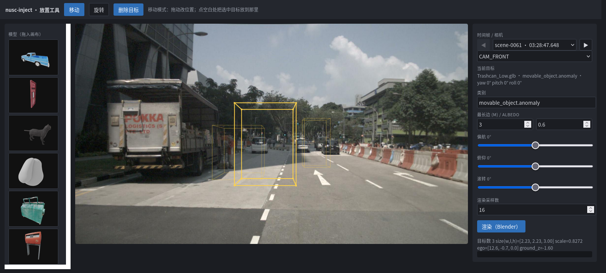
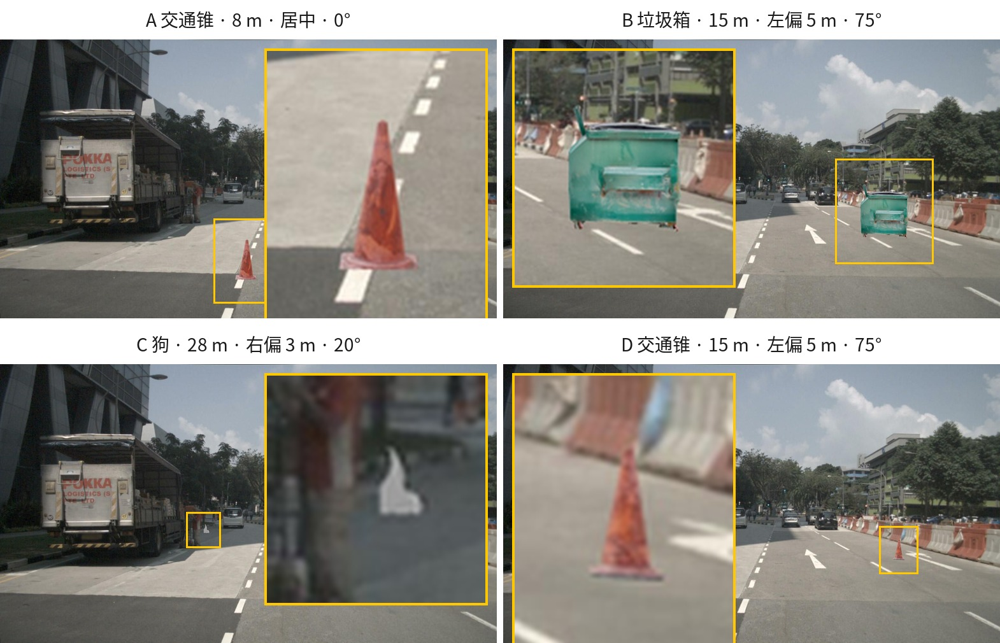

# nusc-inject — nuScenes 点云 + 图像同步注入

向 nuScenes 的 LiDAR 点云与相机图像中**同步、几何一致**地注入第三方（OoD）3D 目标，
并导出**标准 nuScenes 格式**的标注数据集。方法详见 `nuScenes点云图像同步注入方法.md`。


*左：原始 nuScenes `CAM_FRONT`；右：注入蓝色皮卡后——同一位姿同时驱动点云与图像。*
*黄框为注入区域，右上角为其放大（目标只占整帧约 4%，满幅看不清）。*

> 📄 **参考手册**（模型参数 / `data/` 目录 / 放置 UI 详解）：[docs/reference.md](docs/reference.md)
> ｜ **图文工作总结**（逐图说明、验收细节、踩坑记录）：[docs/summary/README.md](docs/summary/README.md)
> ｜ **实测数据存档**（M1–M11 原始输出与复现命令）：[docs/measurements.md](docs/measurements.md)

---

## 一、它是怎么做的


**一个真值，两个通道。** 每个注入目标只有一个 `T_model2global`（4×4 刚体变换），
LiDAR 通道与相机通道都由它推导——所以点云里那个点和图像里那块像素，
几何上必然对齐，不存在「两边各摆一次」的漂移。

七步流水线（`pipeline.run_sample`，`run_p0.py` 与 `run_batch.py` 共用）：

| Step | 做什么 | 关键文件 |
|---|---|---|
| 1 | 锚点位姿：ego 系偏移 + 姿态 → 单一真值 `gt` | `anchor.py` |
| 2 | LiDAR：球面 range-image 双向遮挡 + Lambertian 强度 | `lidar_channel.py` |
| 3 | 相机：视锥剔除 → 一次 Blender job 渲 RGBA 前景 | `camera_channel.py` |
| 4 | 深度遮挡 + alpha 合成回原图 | `composite.py` |
| 5 | 标注行生成 + nuScenes 数据集导出 + devkit 校验 | `annotation.py` |
| 6 | 一致性校验（往返残差 / 覆盖率 / 遮挡理由 / 尺寸） | `validate.py` |
| 7 | 叠加可视化（BEV、点云-图像对照） | `visualize.py` |

几个决定正确性的设计：

- **遮挡语义**：物体↔场景双向剔除，场景点之间**不去重**——保证原始点云除被遮挡处外逐点保留。
- **`sample_annotation.size` 轴序是 `[w, l, h]`**（`l` 沿框 x、`w` 沿框 y），不是 `[x, y, z]`。
  写错会让一辆车的遮挡体在地面转 90°，遮挡功能整体失效。
- **贴地按网格最低顶点**，不是包围盒角点——网格只在少数点接触自己的包围盒，
  按角点落地会让倾斜的目标悬空。
- **放置参数用 ego 系表达**（x 前、y 左、z 上），内部换算到 `LIDAR_TOP`（相对 ego 有约 −90°
  偏航 + 1.4° 俯仰的安装旋转）；姿态用 ZYX 内旋欧拉角。

---

## 二、快速开始

### 1. 环境

```bash
# 0) 获取代码
git clone git@github.com:SHUAIHUANGEIPTEC/NUSC_inject.git && cd NUSC_inject

# 1) Blender 3.6.23 LTS（独立包，自带 Python/numpy）
bash scripts/setup_blender.sh          # -> tools/blender/blender

# 2) conda 环境（依赖版本已全部固定）
conda env create -f environment.yml    # env: nusc-inject
conda activate nusc-inject

# 3) 安装本包（editable；脚本按包名 import，不再依赖 sys.path 注入）
pip install -e .

# 4) （可选）Objaverse 模型下载支持
pip install -e ".[models]"
python scripts/download_models.py --uids <uid1> <uid2>   # -> assets/models/*.glb
```

### 2. 数据与模型

配置里的路径都是**相对仓库根目录**的，无需改动即可运行（由 `nusc_inject.config.load_config` 统一解析）。

```
assets/
└── models/                  # 【入库】12 个 .glb（约 38 MB）+ 逐个许可说明，克隆即有

data/
├── nuscenes/                # 【你提供】nuScenes 根目录，建议软链到仓库外
│   ├── v1.0-mini/           #   13 张元数据表
│   ├── samples/             #   keyframe 相机 + LIDAR_TOP
│   └── sweeps/  maps/
├── models/                  # 【管线生成】演示盒子 / 轴向对照模型（可随时重生成）
├── outputs/                 # 【管线生成】运行产物，可随时删
└── exports/                 # 【管线生成】nuScenes 格式数据集，即交付物
```

`assets/models/` 自带 12 个可注入模型：**交通锥、垃圾桶、垃圾箱、停车牌、路牌、电线杆、
邮筒、邮箱、猫、狗、护栏类**，以及皮卡 `temple.glb`——许可（11 个 CC-BY、1 个来源见说明）
与逐个来源见 **[`assets/models/README.md`](assets/models/README.md)**。

另外 `assets/models/` 下还有一次**公路 OoD 批量下载**（`scripts/download_road_ood.py`，
约 3400 个、18 GB），按 `*_????????.glb` 命名模式被 `.gitignore` 忽略、**不入库**；
清单与类目文档在 `assets/models/road_ood_docum/`。要加自己的模型就丢进 `assets/models/`，
再改 `configs/*.yaml` 的 `model.path`（单目标）或 `models[].path`（批量模型池）。
支持 `.glb / .gltf / .obj / .fbx / .ply`（glTF 的 Y-up 按 Blender 导入规则自动换算）。

`data/` 全部是运行期数据、不进版本控制、克隆后并不存在；逐目录内容、体积与清理方式见
**[`docs/reference.md`](docs/reference.md) 第二部分**。

### 3. 跑起来

```bash
# 单样本单目标（P0 快速验证，约 30 s）
python scripts/run_p0.py --config configs/p0.yaml --run-id my_run

# 批量注入 + 落库 + 导出（10 scene，约 6 min）
python scripts/run_batch.py --config configs/batch.yaml --run-id my_batch

# 只重导出（复用已有 specs.json，不过 Blender，约 10 s）
python scripts/run_batch.py --config configs/batch.yaml --export-only
```

下游直接用 devkit 加载：

```python
from nuscenes.nuscenes import NuScenes
from nusc_inject.annotation import patch_devkit_colormap
nusc = NuScenes(version='v1.0-mini', dataroot='data/exports/nuscenes-od-p0')
patch_devkit_colormap(nusc, 'movable_object.anomaly')   # render_* 前打一次
# 过滤注入目标：默认导出用 category == movable_object.anomaly 即可；
# 若复用了已有类目（如 human.pedestrian.adult），必须按 token 过滤：
#   injected = set(json.load(open(export_report))['export']['instance_tokens'])
```

---

## 三、交互式放置 UI（可选）

改位姿时「改配置 → 跑 30 秒 → 看图」的循环太慢，可以开一个本地放置界面：

```bash
python scripts/annotate_ui.py --open    # -> http://127.0.0.1:8765
```



*左侧素材面板把模型缩略图**拖进画布**即插入目标（黄线框）——这里是交通锥、狗、*
*垃圾桶三个不同类目的真实模型，各自独立位姿，一次渲染全部。右侧控件绑定当前目标。*
*「时间帧」一栏的 `◀ ▶` 逐帧翻 nuScenes 关键帧，下拉里是「场景 · 时刻」的全部 404 帧。*

**直接操纵**：拖缩略图/类目 chip 进画布插入（拖几个就是几个，多目标一次渲染）；
「移动」模式拖位置、「旋转」模式拖姿态（拖 X=偏航、Y=俯仰、Shift+拖=滚转）；
点线框选中、点「删除目标」移除。线框由 `anchor.build_gt` 生成——**预览即实际**，
满意后点「渲染」跑真实管线。

零新增依赖（stdlib `http.server` + 单页 HTML/Canvas）。完整使用明细（界面分区、
控件与配置字段对照、输出结构、已知限制、截图重建）见
**[`docs/reference.md`](docs/reference.md) 第三部分**。

---

## 四、验收结果

v1.0-mini 全量轨迹注入（10 scene，`seed=42`，`configs/batch.yaml`，82 帧）：

| 校验项 | 实测 | 阈值 |
|---|---|---|
| 校验通过 | 82/82 帧，0 失败 | — |
| 坐标链往返残差 | 3.4e-13 | <1e-6 |
| num_lidar_pts（逐目标） | 3 – 12000，全部 >0 | >0 |
| 尺寸合理性（最长边） | 2.71 – 3.88 m | 0.05 – 40 m |
| Blender 内参自检 | 0.358 px | <2 px |
| 点投影 ⊂ α 区域覆盖率 | 均值 0.993（最小 0.974；不可测者按边缘豁免） | ≥0.85 |
| 3D 框投影 IoU | 均值 0.813（4 例低于阈值均为触边豁免） | ≥0.5 |
| **遮挡理由一致性** | **0 违例**（被遮挡像素均有更近几何） | 0 |
| 遮挡成效 | 6.38% 目标像素被场景正确隐藏 | — |

> 数字随放置采样与遮挡实现变动；逐帧明细见 `validation_report.json` 与 `export_report.json`，
> 每项的复现方式与原始输出见 [`docs/measurements.md`](docs/measurements.md)。

**跨模态一致性**——左：注入的 LiDAR 点（红）密铺在渲染轮廓（绿）内；右：BEV，红色即目标在自车前方：


**不同位置 / 类目 / 材质的效果**——四个真实模型（交通锥 / 垃圾箱 / 狗）在同帧注入，
A 与 D 同模型改距离、B 与 D 同位置换模型：



四组结论（强度、距离、遮挡的量化）见 [`docs/measurements.md`](docs/measurements.md) 的 M10。

---

## 五、测试

```bash
pip install -e ".[dev]"    # 或直接用 conda 环境里已装好的 pytest
pytest                     # 159 passed，≈0.5s，不需要 nuScenes 数据与 Blender
```

| 文件 | 用例 | 覆盖 |
|---|---|---|
| `test_anchor.py` | 28 | 缩放 / ego↔lidar 换算 / gt 变换对 / `from_global` scale 回收 / 网格顶点贴地 / 退化保护 |
| `test_lidar_channel.py` | 19 | 双向遮挡语义 / 遮挡体 / gap-fill / 强度 / 注入 |
| `test_annotation.py` | 18 | 确定性 token / 导出表 / 跨帧 prev-next 链 / 来源清单 |
| `test_transforms.py` | 16 | 四元数往返 / 欧拉角方向与合成 / 坐标链 / `view_points` |
| `test_occluders.py` | 15 | `[w,l,h]` 轴序 / 盒面点 / 逐像素面深度 / gap-fill 半径 |
| `test_composite.py` | 12 | z-buffer / 可见性规则 / 深度洞 / 深度比例 margin |
| `test_validate.py` | 12 | 遮挡理由一致性 / 尺寸阈值 / 不可测覆盖率豁免 |
| `test_range_image.py` | 11 | 球面分箱 / `dilate_min_map` |
| `test_mesh_points.py` | 9 | Y-up 转换 / 表面积+质心签名 / 细分不变性 |
| `test_nusc_io.py` | 6 | `.pcd.bin` I/O |
| `test_config.py` | 5 | `extends` 合并 / 路径解析 |
| `test_ui_geometry.py` | 8 | 放置 UI 的反投影往返 / ego 系换算 / 天空点拒绝 / 多目标预览一致 / 缩略图 job 框幅 |

需要真实数据的端到端校验由运行时 Step-6 输出的 `validation_report.json` 给出。

---

## 六、产物与目录

两条产物流：

| 位置 | 是什么 | 能否删 |
|---|---|---|
| `data/outputs/p0/<run_id>/` | **过程**：每帧的真值、注入点云、渲染前景、合成图、深度缓冲、校验报告 | 可，重跑即得 |
| `data/exports/nuscenes-od-p0/` | **交付物**：标准 nuScenes 格式数据集，devkit 可直接加载 | 谨慎，`specs.json` 是来源凭证 |

导出目录里 `samples/` 只有被注入替换过的文件是实拷，其余是软链指回原数据集
（所以 84M 就能独立加载，但**原数据集不能删**）。逐文件清单、体积构成、按通道归属与
清理方式见 **[`docs/reference.md`](docs/reference.md) 第二部分**。

仓库结构：

```
pyproject.toml                 # 打包 / 依赖 / pytest 配置
environment.yml                # conda 环境（版本全部固定）
configs/base.yaml              # 共享配置块（p0/batch 通过 extends 继承）
configs/p0.yaml / batch.yaml   # 各自差异项
assets/models/                 # 入库的第三方模型 + 许可说明
scripts/                       # 见下表
tests/                         # pytest 单测（不需要数据与 Blender）
src/nusc_inject/               # 见下表
```

| 脚本 | 用途 |
|---|---|
| `setup_blender.sh` | 下载 Blender 3.6.23 到 `tools/` |
| `run_p0.py` / `run_batch.py` | 单样本验证 / 批量注入 + 落库 + 导出 |
| `annotate_ui.py` | 交互式放置 UI |
| `download_models.py` / `download_road_ood.py` | 从 Objaverse 拉模型（按 uid / 按公路 OoD 类目） |
| `make_demo_models.py` | 生成演示盒子（`data/models/demo_*.glb`） |
| `make_doc_fixtures.py` / `make_doc_figs.py` | 重建文档出图素材 / 重出图 1–6 |
| `make_ui_screenshots.py` | 重出 UI 截图（兼作 UI 端到端冒烟测试） |

| 模块 | 职责 |
|---|---|
| `config.py` | 配置加载（`extends` 合并 + 相对路径解析） |
| `transforms.py` | 四元数 / 坐标链 / OpenCV↔Blender 相机转换 / 欧拉角 |
| `nusc_io.py` | 元数据（keyframe 过滤）+ lidar `.bin` I/O |
| `anchor.py` | Step1 锚点位姿 + gt（多目标逐个生成，含贴地） |
| `mesh_points.py` | 表面采样（glTF→Blender 系）+ 形状签名 |
| `range_image.py` | 球面 range-image 分箱（LiDAR 通道与遮挡体共用） |
| `lidar_channel.py` | Step2 双向遮挡 + Lambertian 强度 |
| `camera_channel.py` | Step3 视锥剔除 + Blender 调度（多目标 job） |
| `blender_render.py` | 【Blender 内】bpy 渲染 + 内参自检 |
| `occluders.py` | `sample_annotation` 3D 框作稠密遮挡体（两通道共用） |
| `composite.py` | Step4 深度遮挡 + alpha 合成（多目标） |
| `validate.py` | Step6 一致性校验（多目标 / 边缘目标处理） |
| `pipeline.py` | 共享单样本流程（`run_p0` 与 `run_batch` 复用） |
| `annotation.py` | Step5 标注行生成 + 数据集导出 + devkit 校验 |
| `visualize.py` | 叠加可视化 |

---

## 七、已验证事实

- nuScenes 原生 `samples/LIDAR_TOP/*.pcd.bin` 为 float32 **(N,5)**（含 ring 列），本仓库默认按此写出。
- **`sample_data.json` 中 sweep 也带 `sample_token`**：读取某 sample 的传感器数据必须过滤
  `is_key_frame=True`（否则可能拿到时间戳不一致的 sweep 帧）。
- Blender 相机内参映射（3.6.23 自检通过，误差 < 0.001px）：
  `lens = fx·36mm/W`，`shift_x = -(cx-W/2)/W`，`shift_y = +(cy-H/2)/W`，`sensor_fit='HORIZONTAL'`。
- Blender 世界系 ≡ nuScenes 全局系（右手 z-up）；相机系相差绕 X 轴 180°（`diag(1,-1,-1)`）。
- **`LIDAR_TOP` 相对 ego 约有 −90° 偏航安装旋转**（`R_l2e≈Rz(-90°)`，实测另有约 1.4° 俯仰）：
  lidar 的 +x 指向 ego 右、+y 指向 ego 前。放置参数用 ego 系表达，anchor 内部按矩阵合成换算。
- **glTF 模型坐标**：trimesh 保持文件的 Y-up，Blender 导入转 Z-up（`(x,y,z)→(x,-z,y)`）。
  `mesh_points.py` 统一转换，运行时做 bbox + 表面积 + 面积质心漂移对账（超阈值即 fail）。
- **`sample_annotation.size` 的轴序是 `[w, l, h]`，不是 `[x, y, z]`**：nuScenes 的框以
  **长度 `l` 为 x 轴、宽度 `w` 为 y 轴**（devkit `Box.corners`）。`anchor.py` 落库时把模型框的
  `(x,y,z)` 边长映射为 `[y, x, z]`，`occluders._wlh_half_extents` 是唯一读入口——
  直接把 `size[0]` 当 x 边长会让一辆车的遮挡体在地平面转 90°。
- **稀疏回波的 gap-fill 必须按角度、不能按米制**：VLP-32 只有 32 束而 range-image 是 512 行，
  不做膨胀时一堵未标注实墙会漏掉约 88% 的遮挡；束间距的物理尺寸随距离增长，
  米制半径填不满。两通道均按 `scene_gap_fill_deg`（默认 0.7°，约半束间距）膨胀。
- **仍存在的遮挡边界（使用时需知）**：
  - 遮挡体框面按**逐像素平面深度**光栅化（`occluders._face_depth`）；穿过相机平面的面会被跳过。
  - `composite` 的物体深度是**表面采样点投影**的 z-buffer，不是 Blender 的 z-pass。
    α 掩码内未采到的像素先做邻域填补，仍填不上则按「未知即可见」回退，不会被误删。
  - 边缘目标（掩码触边）：LiDAR 点可能整体落在画幅外，使覆盖率**无法测量**（而非为 0）。
    此时与 bbox IoU 同样豁免该相机的覆盖率约束；只要覆盖率可测就始终是硬约束。
  - 物体点超出俯仰 FOV 会被 LiDAR 通道丢弃，而相机侧仍渲染——极高目标两通道可能不一致。
- 自定义类别渲染：devkit `render_*` 需 `patch_devkit_colormap(nusc, category_name)` 注册颜色。
- **下载来的模型不保证长轴在 x 上**：`temple.glb`、`Dog.glb` 等的长轴在 y，
  标注会读作「宽」——几何自洽、不影响注入，只是语义反了（见 `assets/models/README.md`）。
- **模型文件不保证公制单位**：`Cat.glb`、`Dog.glb` 的原始 bbox 是几百到几千单位，
  靠 `model.target_max_dim_m` 归一。

---

## 八、后续（超出当前范围）

- 跨帧 instance 跟踪（prev/next 链）、多 sweep 注入
- map API 选点（`flat.driveable_surface`）、Inpainting 替换真实目标
- 批量到 150 scene / 训练数据集生产

---

## 九、许可

- **本仓库代码**：MIT，见 [LICENSE](LICENSE)。
- **nuScenes 数据**：由 Motional 发布，遵循 **CC BY-NC-SA 4.0（非商业性使用）**，
  需自行下载并同意其条款；本仓库**不包含**任何 nuScenes 原始数据。
- **`docs/summary/figs/` 中的图像**为 nuScenes 相机图像的衍生结果，版权与许可随原始数据，
  仅作方法说明，**不得商用**。
- **`assets/models/` 中的 3D 模型**保留各自许可（11 个 CC-BY 4.0、1 个来源见说明），
  逐个来源与许可见 [`assets/models/README.md`](assets/models/README.md)；
  批量下载的公路 OoD 模型不入库，其清单与许可记录在 `assets/models/road_ood_docum/`。
