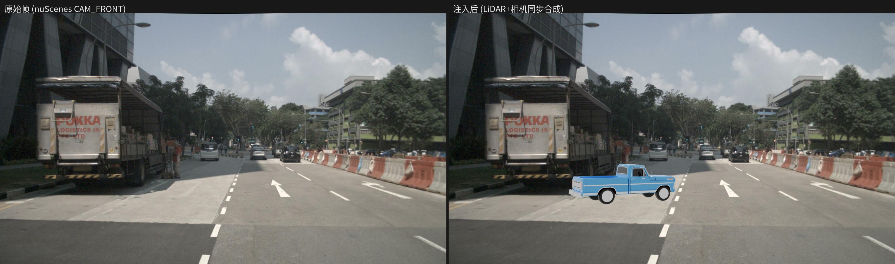
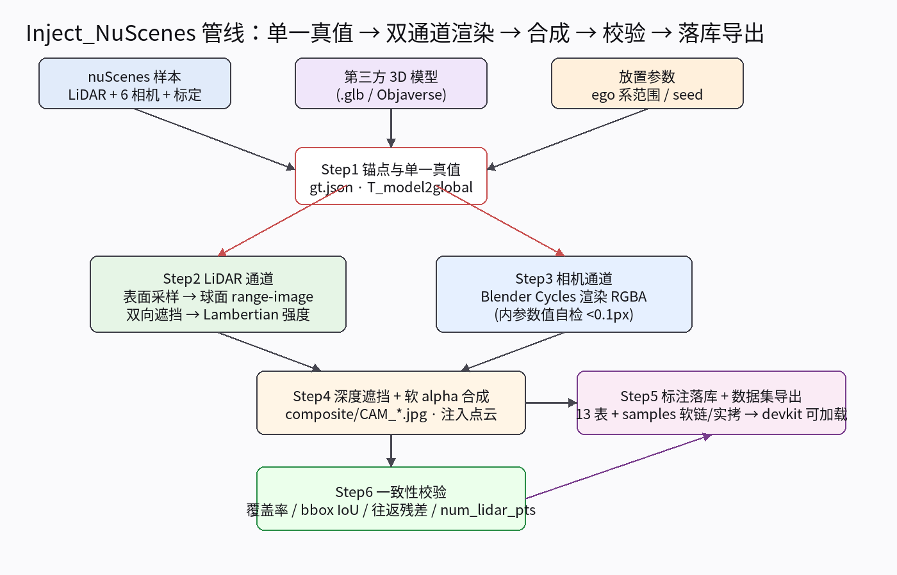
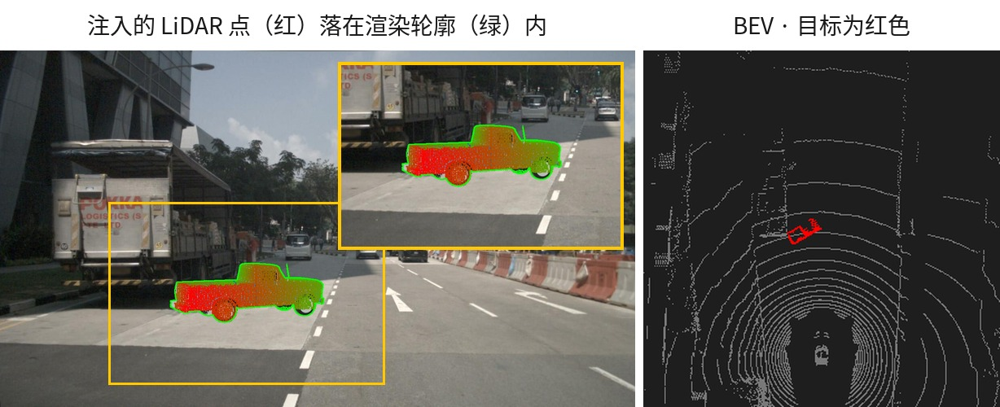

# nusc-inject — nuScenes 点云 + 图像同步注入（P0 + Step5 落库 + 批量）

向 nuScenes 的 LiDAR 点云与相机图像中**同步、几何一致**地注入第三方（OoD）3D 目标，
并生成**标准 nuScenes 格式**的标注数据集导出。方法详见 `nuScenes点云图像同步注入方法.md`。



*左：原始 nuScenes `CAM_FRONT`；右：注入蓝色皮卡后——同一位姿同时驱动点云与图像。*
*黄框为注入区域，右上角为其放大。*

> 📄 **图文工作总结**（含管线流程图、验收数据、踩坑记录）：[docs/summary/README.md](docs/summary/README.md)
> ｜ 模型输入格式与参数：[docs/model-input.md](docs/model-input.md)
> ｜ 交互式放置 UI：[docs/placement-ui.md](docs/placement-ui.md)
> ｜ `data/` 目录结构与清理：[docs/data-layout.md](docs/data-layout.md)
> ｜ 实测数据存档：[docs/measurements.md](docs/measurements.md)

## 设计核心



- **单一真值源**：每个目标的 `T_model2global`（含归一化 + 缩放 + 位姿）同时驱动 LiDAR 与相机两个通道。
- **LiDAR 通道**：trimesh 面积加权表面采样 → 球面 range-image 双向遮挡（物体↔场景，场景点不去重；`sample_annotation` 3D 框作为稠密遮挡体填补无回波面）→ Lambertian 强度。
- **相机通道**：Blender 3.6 headless 渲染 RGBA 前景（Cycles CPU）→ 深度遮挡判定（LiDAR 稀疏深度 + `sample_annotation` 框面逐像素光栅化）→ 软 alpha 合成。
- **一致性校验**：注入点投影 ⊂ α 区域覆盖率、3D 框投影 IoU、坐标链往返、Blender 内参自检、num_lidar_pts。
- **Step5 落库**：`category/attribute/instance/sample_annotation` 四表追加行，导出可被 `nuscenes-devkit` 直接加载的数据集。

两个通道共用一套真值，因此注入的 LiDAR 点（下图红）会精确落在渲染轮廓（绿）内
（左侧为原图 + 放大内嵌；右侧 BEV 已裁到目标附近，红色即目标）：



## 环境搭建

```bash
# 0) 获取代码
git clone git@github.com:SHUAIHUANGEIPTEC/NUSC_inject.git
cd NUSC_inject

# 1) Blender 3.6.23 LTS（独立包，自带 Python/numpy）
bash scripts/setup_blender.sh          # -> tools/blender/blender

# 2) conda 环境（依赖版本已全部固定）
conda env create -f environment.yml    # env: nusc-inject
conda activate nusc-inject

# 3) 安装本包（editable；脚本按包名 import，不再依赖 sys.path 注入）
pip install -e .

# 4) （可选）Objaverse 模型下载支持
pip install -e ".[models]"
python scripts/download_models.py --uids <uid1> <uid2>   # -> data/models/*.glb
```

## 数据准备

配置里的路径都是**相对仓库根目录**的，无需改动即可运行（由 `nusc_inject.config.load_config` 统一解析）：

```
data/
├── nuscenes/                # 【你提供】nuScenes 根目录，建议软链到仓库外
│   ├── v1.0-mini/           #   13 张元数据表
│   ├── samples/             #   keyframe 相机 + LIDAR_TOP
│   └── sweeps/  maps/
├── models/                  # 【你提供】任意 .glb/.gltf/.obj/.fbx/.ply
├── outputs/                 # 【管线生成】运行产物，可随时删
└── exports/                 # 【管线生成】nuScenes 格式数据集，即交付物
```

`data/` 全部是运行期数据、不进版本控制，克隆后并不存在。每个子目录的内容、产生者、
体积构成与清理方式见 **[`docs/data-layout.md`](docs/data-layout.md)**。

把模型放到 `data/models/` 后，改 `configs/*.yaml` 中的 `model.path`（单目标）或
`models[].path`（批量模型池）指向该文件。支持 `.glb / .gltf / .obj / .fbx / .ply`
（glTF 的 Y-up 会按 Blender 导入规则自动换算，见「已验证事实」）。

> 模型格式、材质处理方式、每个参数的含义与常见坑，见
> **[`docs/model-input.md`](docs/model-input.md)** — 其中说明了相机通道原样透传模型材质、
> LiDAR 通道只用一个标量 `albedo`，以及两者亮度需要人工对齐这一点。

## 运行

### 单样本单目标（P0 快速验证）

```bash
python scripts/run_p0.py --config configs/p0.yaml --run-id my_run
```

### 批量注入 + 标注落库 + 数据集导出

```bash
python scripts/run_batch.py --config configs/batch.yaml
# 参数覆盖 / 只导出：
python scripts/run_batch.py --config configs/batch.yaml --samples 0 1 2
python scripts/run_batch.py --config configs/batch.yaml --export-only   # 重导出
python scripts/run_batch.py --config configs/batch.yaml --skip-export   # 只注入
```

被场景完全遮挡的目标会被**丢弃**（0 个 LiDAR 点 / 无相机可见），不会让整帧失败——
与跨帧轨迹模式的 `drop_invisible` 行为一致；只有「全部目标都不可见」或校验不过才跳过该帧。
丢弃情况记在 `specs.json` 的 `summary.n_objects_dropped` / `summary.dropped`。

`configs/batch.yaml` 关键项：
- `dataset.sample_indices`：要注入的 sample 列表
- `models:`：模型池（每个目标随机取一个；`target_max_dim_m` 可为标量或 `[lo,hi]` 随机区间）
- `objects.count`：每帧目标数；`forward_range_m / lateral_range_m / yaw_in_ego_deg_range`：ego 系随机放置范围；`min_spacing_m`：目标间最小间距；`seed`：确定性随机
- `annotation.category_name / attribute_name / visibility_token`：落库类别/属性/可见度
- `export_dir`：导出数据集根目录（默认 `data/exports/nuscenes-od-p0`）

### 交互式放置（可选）

调位姿时「改配置 → 跑 30 秒 → 看图」的循环太慢，可以开一个本地放置界面：

```bash
python scripts/annotate_ui.py --open    # -> http://127.0.0.1:8765
```


*左侧素材面板把模型缩略图**拖进画布**即插入目标（黄线框），右侧控件绑定当前目标。*
*「时间帧」一栏的 `◀ ▶` 逐帧翻 nuScenes 关键帧，下拉里是「场景 · 时刻」的全部 404 帧。*

在相机图上**直接操纵**：拖缩略图或类目 chip 进画布插入目标（拖几个就是几个，多目标一次
渲染）；「移动」模式拖动改位置、「旋转」模式拖动改姿态（拖 X=偏航、拖 Y=俯仰、
Shift+拖=滚转）；点线框选中、点「删除目标」移除。线框预览实时跟随，满意后点「渲染」
跑真实管线（Blender 在后台线程，页面轮询进度）。

- **零依赖**：只用 stdlib `http.server` + 单页 HTML/Canvas，不引入 gradio/streamlit。
- **预览即实际**：线框由 `anchor.build_gt` 生成——和真正渲染走同一条代码路径，
  不存在「预览和结果不一致」。
- 渲染结果落在 `data/outputs/ui/run_*/`，与命令行产物结构相同。

完整使用明细（界面分区、控件与配置字段对照、输出结构、已知限制、截图重建）
见 **[`docs/placement-ui.md`](docs/placement-ui.md)**。

## 测试

```bash
pip install -e ".[dev]"    # 或直接用 conda 环境里已装好的 pytest
pytest                     # 159 passed，≈0.5s，不需要 nuScenes 数据与 Blender
```

| 文件 | 用例 | 覆盖 |
|---|---|---|
| `test_anchor.py` | 28 | 缩放 / ego↔lidar 换算 / gt 变换对 / `from_global` scale 回收 / 网格顶点贴地 / 退化保护 |
| `test_lidar_channel.py` | 19 | 双向遮挡语义 / 遮挡体 / gap-fill / 强度 / 注入 |
| `test_annotation.py` | 18 | 确定性 token / 导出表 / 跨帧 prev-next 链 / 来源清单 |
| `test_transforms.py` | 16 | 四元数往返 / 欧拉角方向与合成 / 坐标链 / `view_points` |
| `test_occluders.py` | 15 | `[w,l,h]` 轴序 / 盒面点 / 逐像素面深度 / gap-fill 半径 |
| `test_composite.py` | 12 | z-buffer / 可见性规则 / 深度洞 / 深度比例 margin |
| `test_validate.py` | 12 | 遮挡理由一致性 / 尺寸阈值 / 不可测覆盖率豁免 |
| `test_range_image.py` | 11 | 球面分箱 / `dilate_min_map` |
| `test_mesh_points.py` | 9 | Y-up 转换 / 表面积+质心签名 / 细分不变性 |
| `test_nusc_io.py` | 6 | `.pcd.bin` I/O |
| `test_config.py` | 5 | `extends` 合并 / 路径解析 |
| `test_ui_geometry.py` | 8 | 放置 UI 的反投影往返 / ego 系换算 / 天空点拒绝 / 多目标预览一致 / 缩略图 job 框幅 |

需要真实数据的端到端校验由运行时 Step-6 输出的 `validation_report.json` 给出。
各次决策背后的实测复现记录见 [`docs/measurements.md`](docs/measurements.md)。

## 产物

两条产物流：

| 位置 | 是什么 | 能否删 |
|---|---|---|
| `data/outputs/p0/<run_id>/` | **过程**：每帧的真值、注入点云、渲染前景、合成图、深度缓冲、校验报告 | 可，重跑即得 |
| `data/exports/nuscenes-od-p0/` | **交付物**：标准 nuScenes 格式数据集，devkit 可直接加载 | 谨慎，`specs.json` 是来源凭证 |

导出目录里 `samples/` 只有被注入替换过的 125 个文件是实拷，其余 4723 个是软链指回原数据集
（所以 84M 就能独立加载，但**原数据集不能删**）。

逐文件清单、体积构成、按通道归属与清理方式见 **[`docs/data-layout.md`](docs/data-layout.md)**。

下游直接：

```python
from nuscenes.nuscenes import NuScenes
from nusc_inject.annotation import patch_devkit_colormap
nusc = NuScenes(version='v1.0-mini', dataroot='data/exports/nuscenes-od-p0')
patch_devkit_colormap(nusc, 'movable_object.anomaly')  # render_* 前打一次
# 过滤注入目标：本默认导出用 category == movable_object.anomaly 即可
# 若注入目标复用了已有类目（如 human.pedestrian.adult），必须按 token 过滤：
#   injected = set(json.load(open(export_report))['export']['instance_tokens'])
```

## 已验证事实

- nuScenes 原生 `samples/LIDAR_TOP/*.pcd.bin` 为 float32 **(N,5)**（含 ring 列），本仓库默认按此写出。
- **`sample_data.json` 中 sweep 也带 `sample_token`**：读取某 sample 的传感器数据必须过滤 `is_key_frame=True`（否则可能拿到时间戳不一致的 sweep 帧）。
- Blender 相机内参映射（3.6.23 自检通过，误差 < 0.001px）：
  `lens = fx·36mm/W`，`shift_x = -(cx-W/2)/W`，`shift_y = +(cy-H/2)/W`，`sensor_fit='HORIZONTAL'`。
- Blender 世界系 ≡ nuScenes 全局系（右手 z-up）；相机系相差绕 X 轴 180°（`diag(1,-1,-1)`）。
- **LIDAR_TOP 传感器系相对 ego 约有 -90° 偏航安装旋转**（`R_l2e≈Rz(-90°)`）：lidar 的 +x 指向 ego 右方向、+y 指向 ego 前方。放置参数用 ego 系表达（`offset_in_ego`），anchor 内部换算。
- **glTF 模型坐标**：trimesh 保持文件的 Y-up 坐标，Blender 导入时转为 Z-up（`(x,y,z)→(x,-z,y)`）。`mesh_points.py` 统一转换，运行时 bbox 对账（漂移 >1mm 即 fail）。
- **`sample_annotation.size` 的轴序是 `[w, l, h]`，不是 `[x, y, z]`**：nuScenes 的框以**长度 l 为 x 轴、宽度 w 为 y 轴**（devkit `Box.corners`）。`anchor.py` 落库时把模型框的 `(x,y,z)` 边长映射为 `[y, x, z]`，`occluders._wlh_half_extents` 是唯一读入口——直接把 `size[0]` 当 x 边长会让一辆车的遮挡体在地平面转 90°。
- **遮挡语义**：只做“物体↔场景”双向剔除（物体取每格最近且严格更近；场景点仅被更近的物体剔除），**场景点之间不去重**——保证原始点云除被遮挡处外逐点保留。
- **稀疏回波的 gap-fill**：原始 LiDAR 回波只落在扫描线上（VLP-32：32 束 vs range-image 512 行），
  不做膨胀时一堵未标注实墙会漏掉约 88% 的遮挡。两通道均按 `scene_gap_fill_deg`（默认 0.7°，
  约半条束间距）做**角度**膨胀——米制半径填不满束间距，因为束间距的物理尺寸随距离增长。
  合成实测：墙后目标存活 88% → 0%，空场/墙前目标 100% 存活（不过度遮挡）。
- **仍存在的遮挡边界（使用时需知）**：
  - 遮挡体框面按**逐像素平面深度**光栅化（`occluders._face_depth`）；穿过相机平面的面会被跳过。
  - `composite` 的物体深度是**表面采样点投影**的 z-buffer，不是 Blender 渲染的 z-pass。
    α 掩码内未采到的像素先做邻域填补，仍填不上则按「未知即可见」回退，不会被误删。
  - 边缘目标（掩码触边）：LiDAR 点可能整体落在画幅外，使覆盖率**无法测量**（而非为 0）。
    此时与 bbox IoU 同样豁免该相机的覆盖率约束；只要覆盖率可测就始终是硬约束。
  - 物体点超出俯仰 FOV 会被 LiDAR 通道丢弃，而相机侧仍渲染——极高目标两通道可能不一致。
- 自定义类别渲染：devkit `render_*` 需 `patch_devkit_colormap(nusc, category_name)` 注册颜色。
- 放置在图像边缘/画幅外的目标：α 像素 < `min_alpha_px` 的相机跳过；掩码触边时 bbox IoU 豁免（覆盖率仍约束）。

## 验收结果

v1.0-mini 全量轨迹注入（10 scene，`seed=42`，`configs/batch.yaml`，82 帧）：

| 校验项 | 实测 | 阈值 |
|---|---|---|
| 校验通过 | 82/82 帧，0 失败 | — |
| 坐标链往返残差 | 3.4e-13 | <1e-6 |
| num_lidar_pts（逐目标） | 3 – 12000，全部 >0 | >0 |
| 尺寸合理性（最长边） | 2.71 – 3.88 m | 0.05 – 40 m |
| Blender 内参自检 | 0.358 px | <2 px |
| 点投影 ⊂ α 区域覆盖率 | 均值 0.993（最小 0.974；不可测者按边缘豁免） | ≥0.85 |
| 3D 框投影 IoU | 均值 0.813（4 例低于阈值均为触边豁免） | ≥0.5 |
| **遮挡理由一致性** | **0 违例**（被遮挡像素均有更近几何） | 0 |
| 遮挡成效 | 6.38% 目标像素被场景正确隐藏 | — |

> 上述数字随放置采样与遮挡实现变动，逐帧明细见各次运行的 `validation_report.json`
> 与 `export_report.json`；每项的复现方式与原始输出见 [`docs/measurements.md`](docs/measurements.md)。

## 目录结构

```
pyproject.toml                 # 打包 / 依赖 / pytest 配置
environment.yml                # conda 环境（版本全部固定）
configs/base.yaml              # 共享配置块（p0/batch 通过 extends 继承）
configs/p0.yaml / batch.yaml   # 各自差异项
scripts/  setup_blender.sh | run_p0.py | run_batch.py | annotate_ui.py
          download_models.py | make_demo_models.py | make_doc_fixtures.py | make_doc_figs.py
tests/                         # pytest 单测（不需要数据与 Blender）
src/nusc_inject/
  config.py          # 配置加载（extends 合并 + 相对路径解析）
  transforms.py      # 四元数/坐标链/OpenCV↔Blender 相机转换
  nusc_io.py         # 元数据（keyframe 过滤）+ lidar .bin I/O
  anchor.py          # Step1 锚点位姿 + gt（多目标逐个生成）
  mesh_points.py     # 表面采样（glTF→Blender 系）
  range_image.py     # 球面 range-image 分箱（LiDAR 通道与遮挡体共用）
  lidar_channel.py   # Step2 双向遮挡 + Lambertian 强度
  camera_channel.py  # Step3 视锥剔除 + Blender 调度（多目标 job）
  blender_render.py  # 【Blender 内】bpy 渲染 + 内参自检
  occluders.py       # sample_annotation 3D 框作稠密遮挡体（两通道共用）
  composite.py       # Step4 深度遮挡 + alpha 合成（多目标）
  validate.py        # Step6 一致性校验（多目标/边缘目标处理）
  pipeline.py        # 共享单样本流程（run_p0 与 run_batch 复用）
  annotation.py      # Step5 标注行生成 + 数据集导出 + devkit 校验
  visualize.py       # 叠加可视化
```

## 后续（超出当前范围）

- 跨帧 instance 跟踪（prev/next 链）、多 sweep 注入
- map API 选点（`flat.driveable_surface`）、Inpainting 替换真实目标
- 批量到 150 scene / 训练数据集生产

## 许可

- **本仓库代码**：MIT，见 [LICENSE](LICENSE)。
- **nuScenes 数据**：由 Motional 发布，遵循 **CC BY-NC-SA 4.0（非商业性使用）**，需自行下载并同意其条款；
  本仓库**不包含**任何 nuScenes 原始数据。
- **`docs/summary/figs/` 中的图像**为 nuScenes 相机图像的衍生结果，版权与许可随原始数据，仅作方法说明，**不得商用**。
- 第三方 3D 模型保留各自许可，请勿随仓库分发。
