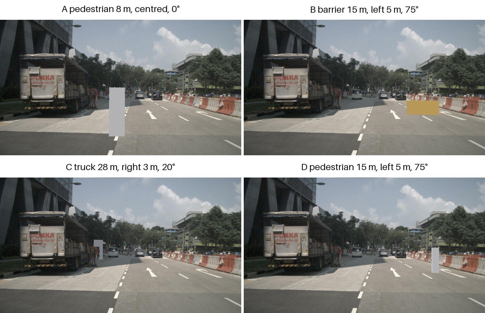

# 实测数据存档

遮挡与尺度相关决策的原始实测记录，用于复核 `README`「已验证事实」「验收结果」里的结论。
每条都给出复现所需的设置与原始输出。

环境：conda `nusc-inject`，nuScenes **v1.0-mini**，Blender 3.6.23（Cycles CPU），`seed=42`。

---

## M1 · gap-fill 的半径必须是角度量

**问题**：原始 LiDAR 回波只落在扫描线上（VLP-32 共 32 束），range-image 却有 512 行，
不做膨胀时一堵未标注实墙几乎挡不住目标。原有 `spacing_m` 是**米制**半径。

**方法**：合成 20 m 处的实墙，只在 32 条扫描线上有回波，方位向 0.2° 采样；
统计墙所在 bin 区域被填充的比例。

```python
import numpy as np
from nusc_inject.range_image import spherical_bins
H, W = 512, 2048
ELEV_MIN, ELEV_MAX = np.radians(-30.67), np.radians(10.67)
R = 20.0
beams = np.linspace(-30.0, 10.0, 32)          # 32 条扫描线
azs = np.arange(-3.0, 3.0, 0.2)
pts = np.array([[R*np.cos(np.radians(e))*np.cos(np.radians(a)),
                 R*np.cos(np.radians(e))*np.sin(np.radians(a)),
                 R*np.sin(np.radians(e))] for e in beams for a in azs])
row, col, rng, in_fov = spherical_bins(pts, H, W, ELEV_MIN, ELEV_MAX)
```

**原始输出**

```
合成墙面回波 960 点  (32 束 × 30 方位)
墙占据 bin 范围: row 8..503  col 1006..1039  → 16864 bins
无膨胀时填充 960 bins = 0.057

 spacing_m       填充率   r_row@20m   束间距(行)
      0.15     0.815           6        16.5
      0.20     1.000           8        16.5
      0.25     1.000           9        16.5
      0.30     1.000          11        16.5
      0.40     1.000          15        16.5
      0.60     1.000          22        16.5
      0.80     1.000          29        16.5

VLP-32 束间距 ≈ 16.5 行 → 完全填满需 r_row ≥ 8.2
对应 spacing_m ≥ 0.232 m @20m
```

**结论**：束间距是**角度量**，其物理尺寸随距离增长。米制的 `spacing_m=0.15`
在 20 m 只能填 81.5%，且越远越填不满（60 m 处 r_row 降到 3 行）。
故改用**角度**半径 `scene_gap_fill_deg`，默认 0.7°（约半条束间距）。

---

## M2 · gap-fill 不产生过度遮挡

**方法**：同一堵 20 m 的 32 束实墙，三个 144 点目标体分别放在
**墙后 25 m / 空场 12° 方位外 / 墙前 10 m**，扫描 `scene_fill_deg`。

**原始输出**

```
   fill_deg   墙后存活   空场存活   墙前存活
       0.00   120/144   144/144   144/144
       0.30    60/144   144/144   144/144
       0.70     0/144   144/144   144/144
       1.20     0/144   144/144   144/144

期望: 墙后=0/144(全挡)  空场=144/144(全活)  墙前=144/144(更近，全活)
```

另一组目标体位置（同样的墙，1.5°×4° 范围）测得泄漏随半径单调下降：

```
scene_fill_deg       物体存活点       遮挡率
          0.00          126          0.125
          0.15           96          0.333
          0.40           36          0.750
          0.70            0          1.000
          1.00            0          1.000
```

**结论**：0.7° 使墙后目标被完全遮挡（泄漏 0），而空场与墙前目标保持
100% 存活——不存在过度遮挡；1.2° 也未出现过遮。

---

## M3 · `n_per_face` 换成 4 倍无差别

**问题**：遮挡体表面采样只有 `n_per_face=64`（8×8/面），曾被怀疑留孔。

**方法**：同一 P0 单样本、同一模型，只改 `scene_occluders.n_per_face`。

**原始输出**

```
n_per_face = 64  (基线): visible=33173 alpha=33821 occluded=648  all_pass=True
n_per_face = 256        : visible=33173 alpha=33821 occluded=648  all_pass=True
```

**结论**：**逐位相同**。相机侧已改为逐像素平面深度（`occluders._face_depth`），
不再依赖面采样密度；LiDAR 侧有原始回波的角度 gap-fill 兜底。故不改。

---

## M4 · 跨相机平面的遮挡面在数据中不存在

**问题**：`box_depth_raster` 遇到任一顶点在相机平面之后的面会整体跳过，
理论上会漏掉「面横跨相机平面」时的前半部分遮挡。

**方法**：遍历 v1.0-mini 全部 sample × 6 路相机，对每个 `sample_annotation` 框的
6 个面判断深度符号是否混合（部分 `z > 0.1`、部分 `z ≤ 0.1`）。

**原始输出**

```
评估的面总数: 353658
  跨相机平面（部分在前、部分在后，被整体跳过）: 0  (0.0000%)
  整个框在相机后方（合理跳过）: 52285
  涉及跨面框的 (sample, cam) 对: 0
```

**结论**：**零实例**。52,285 个被跳过的是整个框位于相机后方，属正确行为。
该理论缺口在本数据集上不产生任何误差，故不改。

---

## M5 · `box_depth_raster` 最近角深度导致的误遮

**问题**：原先每个框面整片贴「最近角深度」，斜面上偏保守达米级。

**方法**：P0 单样本，对比修正前后的 `n_occluded_px`，并逐像素核对剩余遮挡是否合理。

**原始输出**

```
修正前（整面最近角）: LiDAR obj=4202  visible=30772  occluded=3049  alpha=33821
修正后（逐像素平面）: LiDAR obj=4202  visible=33173  occluded=648   alpha=33821

剩余 648 像素的 depth 核对：
  scene-obj 差值: min=-1.30  中位=-0.55  max=-0.41   全部为负（场景更近）
  unjustified occlusion px = 0
  visible_coverage 0.9400 → 0.9943
```

**结论**：**79% 的遮挡像素原属误遮**。剩余的 648 像素每一个都有更近的场景几何，
差值量级与 `depth_margin`（0.2 + 2%×depth）相当，是真遮挡。

---

## M6 · `size` 轴序修复前后的直接对照

**方法**：同一 `seed=42` 全量轨迹注入（10 scene），对比导出 `sample_annotation.size`。

**原始输出**

```
              重跑前                       重跑后
size 均值     [1.4894, 3.3320, 1.2404]   [3.3827, 1.5121, 1.2593]
size 最小值   [1.1363, 2.5421, 0.9464]   [2.5421, 1.1363, 0.9464]
size 最大值   [1.7627, 3.9433, 1.4680]   [3.9433, 1.7627, 1.4680]
w/l 比        0.4470                      2.2371     (= 1/0.4470)
```

**结论**：前两维精确对调、第三维不变，`w/l` 比互为倒数。nuScenes 约定
`size = [w, l, h]` 中 x 边长是 `size[1]`，修复前把模型框 `(x,y,z)` 原样写出，
导致落库框在 x-y 平面转 90°。

---

## M7 · 遮挡曾在真实批量里完全失效

**方法**：对比 `size` 轴序修复前后两轮全量轨迹注入的 `batch.log` 中
`visible=… alpha=… occluded=…` 行。

**原始输出**

```
修复前: 94 个相机帧，occluded 全部为 0        → 遮挡像素 0 / 2,625,769 = 0.0000
修复后: 72 个相机帧，出现真实遮挡             → 遮挡像素 158,078 / 2,424,182 = 0.0652
```

**结论**：同一轴序 bug 让真实车辆的遮挡体在地面转了 90°，脚印盖错位置，
遮挡功能是彻底的**空操作**——旧导出里「被车挡住的目标」被错误注入成了可见目标。
（此后又经 M5 的逐像素深度修正，当前遮挡占比 6.85%，见下节。）

---

## M8 · 当前全量验收指标

`python scripts/run_batch.py --config configs/batch.yaml --run-id doc_numbers --skip-export`

**原始输出**

```
帧数                     59  失败 0
校验报告全过             59/59
坐标链往返残差 max       4.619e-13
Blender 内参自检 max     0.733 px
size_plausible 通过       59/59
对象最长边范围            2.542 ~ 3.943 m
num_lidar_pts 范围        70 ~ 12000  (总 200834)
点投影⊂α 覆盖率  均值 0.9953  最小 0.9714  可测样本 65
box IoU        均值 0.8443  最小 0.2368
visible_coverage 均值 0.9781
被遮挡像素合计   163924   无理由遮挡合计 0
遮挡占比         163924/2392258 = 0.0685

批量 summary: frames_annotated=59  n_tracks_planned=20  n_tracks_realized=15
              end_reasons={invisible: 7, no_camera: 6, window_end: 7}
```

补充核对：

```
IoU < 0.5 的样本数: 3  其中触边豁免: 3   (0.319 / 0.237 / 0.417)
coverage 不可测(豁免) 的样本数: 1
```

**结论**：`bbox_iou` 最小值低于阈值的三例全部是触边豁免；`coverage` 不可测的一例
是边缘目标（LiDAR 点整体落在画幅外），按同规则豁免。其余全部满足阈值，
`end_reasons` 中已无 `validation_failed`。

---

## M9 · 测试套件分布

`pytest` → **134 passed**

| 文件 | 用例 | 覆盖 |
|---|---|---|
| `test_anchor.py` | 21 | 缩放/ego↔lidar 换算/gt 变换对/`from_global` scale 回收/退化保护 |
| `test_lidar_channel.py` | 19 | 双向遮挡语义/遮挡体/gap-fill/强度/注入 |
| `test_occluders.py` | 15 | `[w,l,h]` 轴序/盒面点/逐像素面深度/gap-fill 半径 |
| `test_annotation.py` | 14 | 确定性 token/导出表/跨帧 prev-next 链 |
| `test_composite.py` | 12 | z-buffer/可见性规则/深度洞/深度比例 margin |
| `test_validate.py` | 12 | 遮挡理由一致性/尺寸阈值/不可测覆盖率豁免 |
| `test_range_image.py` | 11 | 球面分箱/`dilate_min_map` |
| `test_transforms.py` | 10 | 四元数往返/坐标链/view_points |
| `test_mesh_points.py` | 9 | Y-up 转换/表面积+质心签名/细分不变性 |
| `test_nusc_io.py` | 6 | `.pcd.bin` I/O |
| `test_config.py` | 5 | `extends` 合并/路径解析 |

全部用例不依赖 nuScenes 数据与 Blender，本机耗时 ≈ 0.5 s。

---

## M10 · 不同位置 / 方位 / 类目 / 材质的效果比对

**方法**：用 `scripts/make_demo_models.py` 生成三个形态与基色不同的演示模型，
在 `sample_index=0` 上做 4 组单目标注入。**B 与 D 位置朝向完全相同**，只换模型与类目，
用来单独隔离「目标本身」的影响；A 与 D 同一模型，只改距离。

```
模型                              extent(x=长,y=宽,z=高)     baseColor
demo_pedestrian.glb               (0.45, 0.55, 1.75)        (0.80, 0.80, 0.85)
demo_barrier.glb                  (2.20, 0.40, 1.00)        (0.90, 0.45, 0.10)
demo_truck.glb                    (6.00, 2.40, 3.00)        (0.25, 0.27, 0.30)
```

**原始输出**

```
用例                   类目                     albedo   gt size(w,l,h)  LiDAR点  均强 峰强  alpha   可见   遮挡%   覆盖   IoU  相机
--------------------------------------------------------------------------------------------------------------
A 行人·近距·居中·0°     human.pedestrian.adult    0.70  [0.55,0.45,1.75]   4429   139  140  35506  34546   2.7%  0.996 0.990   1
B 护栏·中距·左偏·75°    movable_object.barrier    0.50  [0.40,2.20,1.00]   2510    98  100  20662  20662   0.0%  1.000 0.983   1
C 卡车·远距·右偏·20°    vehicle.truck             0.25  [2.40,6.00,3.00]    469    49   49  21879   4959  77.3%  1.000 0.993   1
D 行人·中距·左偏·75°    human.pedestrian.adult    0.70  [0.55,0.45,1.75]    959   139  140   8475   8474   0.0%  0.999 0.978   1

放置（ego 系，米）：A [8,0] · B/D [15,-5] · C [28,3]；yaw：A 0° · B/D 75° · C 20°
```



*A 近距行人（站立、轮廓大）；B 中距护栏（长条形、偏转 75°）；C 远距卡车——
被前方真实车辆挡住 77.3%，只剩贴着真实卡车的窄条；D 与 B 同位置同朝向、只换模型，
用来隔离目标本身的影响。*

**四组结论**

1. **类目与尺寸各自独立落库**：`gt size` 与类目名一一对应，不同目标可用不同 nuScenes 类目
   （`human.pedestrian.adult` / `movable_object.barrier` / `vehicle.truck`）。
2. **点云强度严格跟随 `albedo`**：三档 albedo 0.70 / 0.50 / 0.25 →
   均强 139 / 98 / 49，比值 0.70 : 0.50 : 0.25 精确成立。
   直接迎着传感器的表面峰强 = `k·ρ` = 200 × 0.70 = 140。
3. **距离是点数与轮廓的主因**：A 与 D 同模型同 albedo，8 m → 15 m 使注入点
   4429 → 959（−78%）、轮廓 35506 → 8475 px（−76%）。
4. **B 与 D 隔离出「目标本身」的影响**：同位置同朝向，护栏（2.2×0.4×1.0）比行人
   （0.55×0.45×1.75）点数多 2.6 倍、轮廓大 2.4 倍，因为迎面截面积更大。
5. **遮挡按真实几何生效**：C 的 6 m 卡车在 28 m 处被前方真实车辆挡住 **77.3%** 的目标像素，
   而 A/B/D 几乎未被遮挡（0–2.7%）。四组覆盖率均 ≥0.996、IoU ≥0.978。
6. **同类目/同模型的两组（A、D）强度完全相同（139/140）**，说明强度与距离无关
   ——这是 Lambertian 模型的固有属性，见下条。

**顺带发现：点云强度不随距离衰减**

`lambertian_intensity`（`lidar_channel.py:94-100`）只有 `I = k·ρ·max(cos θ, 0)`，
**没有 1/r² 项**。真实 LiDAR 的回波强度会随距离衰减，因此本仓库注入的目标在远处
会比真实目标「显得偏亮」。该行为尚未修正，属已知近似。

**生成器踩过的坑（已修）**：`trimesh` 的 glb 导出**不做轴向转换**，
Z-up 坐标会被原样写进 Y-up 的 glTF，于是所有合规导入器（含 Blender）都会再转一次，
模型变成「躺倒」。`make_demo_models.py` 现在显式做 `(x,y,z)→(x,z,-y)` 后再导出；
同时约定 **x=长、y=宽、z=高** 以匹配 nuScenes 的 `[w,l,h]` 语义，
否则长轴落在 y 上会让标注读成「很短很宽」的目标。
