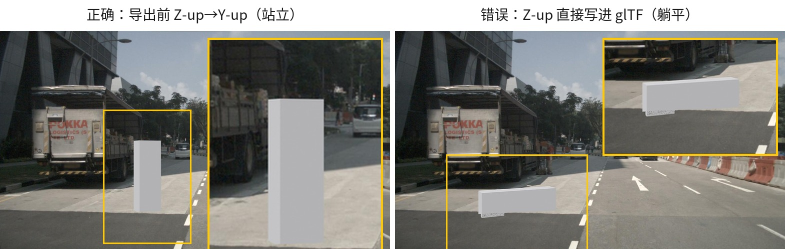

# 第三方目标：输入格式与参数

本文说明「往 nuScenes 里注入什么目标、用什么格式喂进来、有哪些参数可调」。
参数默认值见 `configs/base.yaml`，单/批量差异见 `configs/p0.yaml`、`configs/batch.yaml`。

---

## 1. 支持的文件格式

| 后缀 | Blender 导入器 | 轴向处理 | 材质/贴图来源 |
|---|---|---|---|
| `.glb` | `import_scene.gltf` | Y-up → Z-up 自动换算 | 文件内嵌（PBR + 贴图） |
| `.gltf` | 同上 | 同上 | **外部** `.bin` / 贴图，须与 `.gltf` 同目录且路径正确 |
| `.obj` | `import_scene.obj` | 同上（导入器 `axis_up='Y'`） | 依赖同名 `.mtl` + 外部贴图文件 |
| `.fbx` | `import_scene.fbx` | 同上 | 内嵌或外部贴图 |
| `.ply` | `wm.ply_import` | **不换算**（约定 Z-up） | 顶点色，无 PBR |

`.glb` 是唯一「单文件自包含」的格式，**推荐优先用它**——`.gltf`/`.obj` 一旦贴图路径
失效，模型会以无纹理的默认灰白材质渲染，而且不会报错。

### 坐标与单位

- 单位按 **米** 解释，不做单位换算。一个 1000 单位的 OBJ 会被当成 1000 m 的巨物
  （`validation.max_size_m` 会在校验阶段拒绝它）。
- Blender 世界系 ≡ nuScenes 全局系（右手、z-up）。Y-up 格式由 `mesh_points._to_blender_frame`
  统一做 `(x, y, z) → (x, -z, y)`，**不要自己在模型里预先旋转**，否则会被转两次。
- 运行时有一道**形状敏感漂移守卫**：比对 trimesh 与 Blender 导入后的 bbox、表面积、
  面积加权质心。任一不一致即 FATAL —— 这能抓住「轴向又转了一次」这类问题，
  包括对称包围盒掩盖的那种。

注意漂移守卫**只保证两侧一致，不保证符合你的意图**。下面两张图是同一个网格、
同一个位姿，只有导出时的轴向处理不同：



*左：导出前做了 Z-up → Y-up 转换，行人正常站立（`size=[0.55, 0.45, 1.75]`）；
右：把 Z-up 坐标直接写进 Y-up 的 glTF，两侧仍然一致、校验也通过，
但模型躺平了（`size=[1.75, 0.45, 0.55]`，高度只剩 0.55 m）。*

**所以轴向正确性最终靠你保证**：模型自带坐标必须符合 glTF 的 Y-up 规范，
`mesh_points` 只会按规范转一次。

---

## 2. 材质：两通道分别怎么处理

这是最容易误解的一点：**两个通道对「材质」的用法完全不同。**

### 相机通道 —— 原样透传，代码不编辑任何材质

模型文件里带的材质由 Blender **原样导入**，Cycles 直接渲染。仓库**没有任何材质编辑代码**
（不创建/替换/调参 material 节点）。所以：

- glTF 的 PBR（base color / metallic / roughness / normal / emissive / alpha blend）全部生效；
- 光照是**固定的**：白色世界背景（强度 0.6）+ 一盏太阳灯（energy 3.0，50°/30°）。
  没有逐次运行的光照随机化——遮挡判定与内参自检需要可复现的图像；
- `film_transparent=True`，输出 RGBA PNG（alpha 即目标轮廓）。

**由此带来两条实务约束**：

1. **不透明目标才可靠**。半透明材质（玻璃、纱）会产生部分 alpha，而合成阶段
   只在 `alpha > alpha_threshold`（默认 0.05）的像素上做遮挡判定，半透明边缘会出现
   判定不稳定。
2. **亮度靠材质本身**。想调整目标在图像里的明暗，只能改模型材质，配置里没有对应参数。

### LiDAR 通道 —— 只有一个标量反照率

点云强度用 Lambertian 模型计算：

```
I = clip(k · ρ · max(−d·n, 0), 0, 255)
```

- `ρ` = `albedo`（漫反射率），`k` = `intensity_gain_k`（增益）
- `d` 是点到传感器的单位方向，`n` 是表面法线，所以背向点自然为 0
- 结果只用到模型的**几何**（采样点 + 法线），**不读材质**

也就是说，LiDAR 侧「材质」退化成一个数字：**`albedo`**。没有金属度、粗糙度、
波长相关反射率、透射等概念。想让点云更亮就调 `albedo` 或 `intensity_gain_k`。

两个可直接用的关系（实测见 `docs/measurements.md` M10）：

- **迎面（法线对着传感器）的峰值强度 = `k · ρ`**，例如 `k=200, albedo=0.7` → 140；
- **强度与距离无关**：模型里没有 `1/r²` 衰减项。真实 LiDAR 的回波强度会随距离下降，
  所以注入目标在远处会比真实目标偏亮。这是已知近似。

> ⚠️ **两通道的明暗不会自动一致**：图像亮度来自文件材质，点云强度来自 `albedo`。
> 两者需要人工对齐。例如深色车漆的模型（图像暗）应配较小的 `albedo`，
> 否则会出现「图像里是黑车、点云里却很亮」的违和。

### 关于「材质种类」

代码层面**没有材质种类的概念**，也没有预设材质库——分类完全取决于你喂进来的模型。
若需要不同材质的效果差异，做法是准备不同的模型文件（或同一模型的不同材质版本），
在模型池里并列，用 LiDAR 侧的 `albedo` 对齐点云强度。

---

## 3. 模型级参数

放在 `configs/p0.yaml` 的 `model:`（单目标）或 `configs/batch.yaml` 的 `models:`（模型池，列表）。

| 参数 | 类型 | 默认 | 说明 |
|---|---|---|---|
| `path` | str | **必填** | 模型路径，相对仓库根目录（`load_config` 会转绝对路径） |
| `category` | str | 继承 `annotation.category_name` | 落库用的 **nuScenes 类目名**，如 `movable_object.anomaly`、`movable_object.barrier`。同一 `track` 内必须一致；不同目标可不同类目 || `target_max_dim_m` | float \| [lo,hi] | `3.0` | 缩放后**最长包围盒边**的目标长度（米）。批量模式可写区间随机采样 |
| `scale` | float \| null | `null` | 显式**均匀**缩放。设了就**覆盖** `target_max_dim_m`。不提供非均匀缩放 |
| `albedo` | float | `0.6`（代码缺省 0.5） | LiDAR 漫反射率 ρ，越大点云越亮 |
| `intensity_gain_k` | float | `200.0` | LiDAR 强度增益 k，与 `albedo` 相乘后截断到 0–255 |

`path`、`target_max_dim_m`、`scale` 三者关系：

```
scale 显式给出      → 用 scale（构造时会对 ≤0 / 非有限值报错）
否则                → scale = target_max_dim_m / 模型最长边
```

模型最长边为 0（退化网格）、`target_max_dim_m ≤ 0`、或把区间形式传给非批量脚本，
都会**显式报错**而不是产生 NaN 变换。

> **用已有类目名的注意点**：`category` 可以填 nuScenes 里**已存在**的类目
> （如 `human.pedestrian.adult`），导出时会复用该 category token，注入目标与真实同类
> 目标**在类目上不可区分**——这是有意为之（相当于往既有类别里补样本），但下游若要
> 只取注入目标，必须按 token 过滤而不是按类目过滤：
>
> ```python
> import json
> rep = json.load(open("data/exports/nuscenes-od-p0/export_report.json"))
> injected = set(rep["export"]["instance_tokens"])   # 本次注入的 instance
> ```
>
> `annotation.verify_export` 因此走 token 选择；早期版本按类目筛选，复用已有类目时
> 会把该类的**全部真实标注**都算进去（实测误报 7090 条）。

---

## 4. 放置参数

### 单目标（`configs/p0.yaml` 的 `placement:`）

| 参数 | 默认 | 说明 |
|---|---|---|
| `offset_in_ego` | — | `[前, 左, 上]`，单位米，**ego 系** |
| `yaw_in_ego_deg` | `0` | 偏航，绕 ego **Z** 轴（正 = 逆时针俯视） |
| `pitch_in_ego_deg` | `0` | 俯仰，绕 ego **Y** 轴 |
| `roll_in_ego_deg` | `0` | 滚转，绕 ego **X** 轴 |
| `ground.search_radius_m` | `4.0` | 在该半径内找地面点估计高度 |
| `ground.z_percentile` | `15.0` | 取该分位数作为地面 z |

**姿态约定**：ZYX 内旋欧拉角 —— 先绕 Z 偏航，再绕**新的** Y 俯仰，最后绕**新的** X 滚转
（等价于 `R = Rz(yaw)·Ry(pitch)·Rx(roll)`）。符号按右手定则：

| 正角度 | 效果 |
|---|---|
| `yaw` + | 逆时针俯视旋转 |
| `pitch` + | 物体顶部向 **+X（前）** 倾倒，即「前倾 / 低头」 |
| `roll` + | 物体顶部向 **−Y（右）** 倾倒，即「右倾」 |

> **落地方式**：物体按**最低顶点**贴地，不是按包围盒角点。倾斜后最低点会变，
> `anchor._ground_drop` 会把放置锚点相应抬高/降低，所以倾斜目标不会沉进地面。
> yaw-only 时该修正量恒为 0，不影响既有行为。

> 为什么是 **ego 系**而不是 lidar 系：nuScenes 的 `LIDAR_TOP` 相对 ego 约有 −90° 偏航安装旋转
> （实际标定还带约 1.4° 的俯仰/滚转），直接用 lidar 系会让人对「前方」产生错觉。
> `anchor.py` 内部按 **矩阵合成**换算：`R_lidar = R_l2e^T · R_ego`——
> 不能对角度做标量相减，因为绕 X/Y 的旋转与安装偏航不可交换。

### 批量（`configs/batch.yaml` 的 `objects:`）

| 参数 | 默认 | 说明 |
|---|---|---|
| `count` | `2` | 每帧目标数（tracking 模式下为每场景轨迹数） |
| `forward_range_m` | `[8,30]` | ego 系前向随机范围 |
| `lateral_range_m` | `[-4,4]` | ego 系横向随机范围 |
| `yaw_in_ego_deg_range` | `[0,360]` | 偏航随机范围 |
| `pitch_in_ego_deg_range` | `[0,0]` | 俯仰随机范围（默认固定 0） |
| `roll_in_ego_deg_range` | `[0,0]` | 滚转随机范围（默认固定 0） |
| `min_spacing_m` | `6.0` | legacy 模式目标间最小间距 |
| `seed` | `42` | 确定性随机种子 |
| `tracking.enabled` | `true` | 跨帧轨迹模式（世界系静止目标 + prev/next 链） |
| `tracking.length` | `[3,8]` | 每条轨迹帧数 |
| `tracking.forward_range_m` | `[12,35]` | 轨迹起始的放置范围 |

被场景**完全遮挡**的目标会被丢弃（记在 `specs.json` 的 `summary.dropped`），
不会让整帧失败；只有全部目标都不可见或校验不过才跳过该帧。

---

## 5. 其他相关参数（影响目标外观/数量）

| 配置块 | 参数 | 默认 | 对目标的影响 |
|---|---|---|---|
| `mesh_points` | `n_dense` | `300000` | 表面采样点数——决定点云密度与深度缓冲精度 |
| | `n_lidar` | `12000` | 单目标注入点数上限 |
| `lidar_channel` | `out_format` | `n5` | `n5` 原生 (N,5)；`n4` KITTI 风格 |
| | `range_max_m` | `80` | 超出该距离的目标点丢弃 |
| `camera_channel` | `cycles_samples` | `64` | Cycles 采样数，越高越干净也越慢 |
| | `engine` / `cycles_device` | `CYCLES` / `CPU` | 传给 Blender；有 GPU 可设 `GPU` |
| `composite` | `alpha_threshold` | `0.05` | 低于此 alpha 的像素不参与合成 |
| | `depth_margin_m` / `depth_margin_rel` | `0.2` / `0.02` | 深度容差（常数项 + 距离比例项） |
| `validation` | `min_size_m` / `max_size_m` | `0.05` / `40` | 目标最长边合理区间，超界校验失败 |
| | `min_alpha_px` | `500` | 轮廓小于该像素数的相机整体跳过 |

---

## 6. 常见坑

| 现象 | 原因 | 处理 |
|---|---|---|
| 模型渲染成灰白、无纹理 | `.gltf`/`.obj` 的外部贴图路径失效 | 改用 `.glb`，或把贴图放到模型同目录 |
| `FATAL: trimesh/Blender model-frame mismatch` | 轴向被转了两次（模型内已旋转 + 代码又转） | 模型保持原始轴向，交给代码换算 |
| `FATAL: ... surface area mismatch` | 导入后几何被改变（如非均匀缩放烘焙进模型） | 导出时保持均匀缩放 |
| `ValueError: model bbox has zero extent` | 空网格 / 全共面网格 | 换模型 |
| `ValueError: scale must be a finite positive number` | `scale` ≤ 0 或 NaN | 检查配置或改用 `target_max_dim_m` |
| 目标整体不出现在点云 | 被场景完全遮挡（正常）或超出 `range_max_m` | 看 `specs.json` 的 `summary.dropped` |
| 点云很暗 / 很亮 | `albedo` 与材质不匹配 | 调 `albedo`（图像亮度需改模型材质） |
| 目标比预期大/小 | 误以为按体积或高度缩放 | 缩放基准是**最长包围盒边** |

---

## 7. 最小可运行示例

```bash
# 1) 放模型
cp /path/to/your_model.glb data/models/

# 2) 改 configs/p0.yaml
#    model:
#      path: data/models/your_model.glb
#      category: movable_object.anomaly
#      target_max_dim_m: 3.0
#      albedo: 0.45
#      intensity_gain_k: 200.0

# 3) 跑单样本
python scripts/run_p0.py --config configs/p0.yaml --run-id my_object
```

产物在 `data/outputs/p0/my_object/`：`gt.json`（真值）、`lidar/injected.pcd.bin`、
`blender/CAM_*.png`（RGBA 前景）、`composite/CAM_*.jpg`（合成图）、
`viz/*_overlay.jpg`（叠加可视化）、`validation_report.json`。

批量注入多个不同类目/材质的目标：把多个条目并列在 `configs/batch.yaml` 的 `models:` 下，
每个条目给不同的 `path` / `category` / `albedo`。
