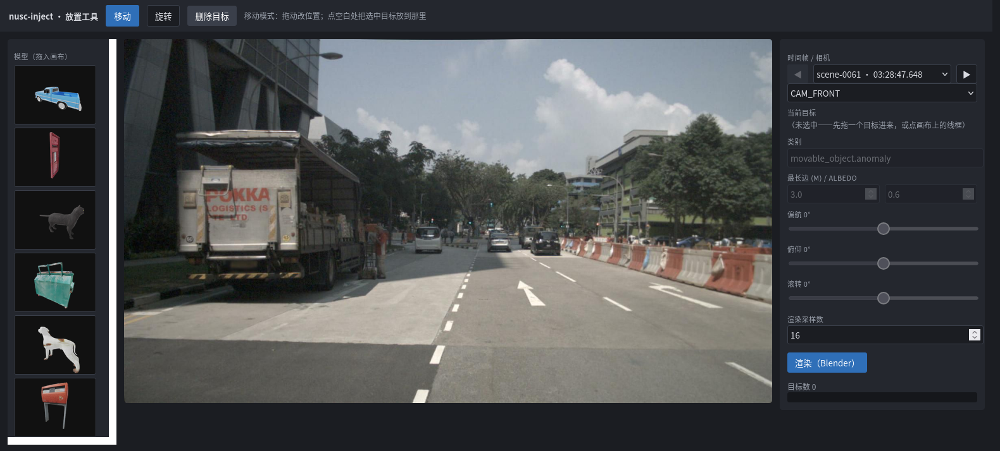
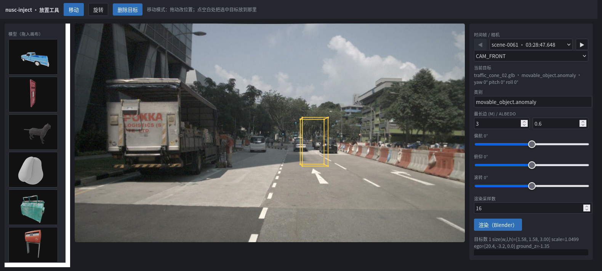
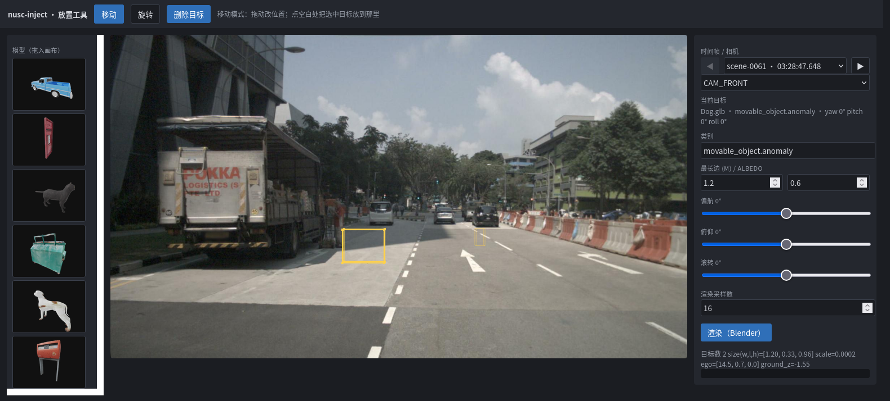
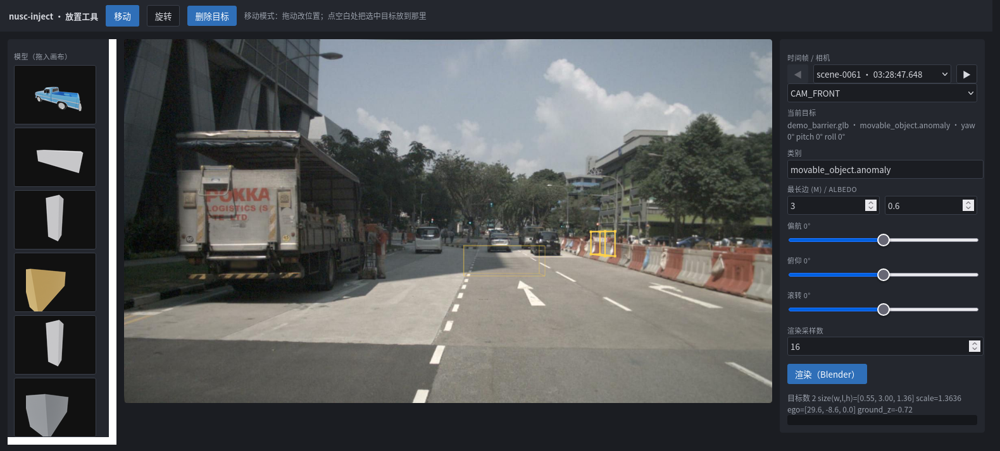
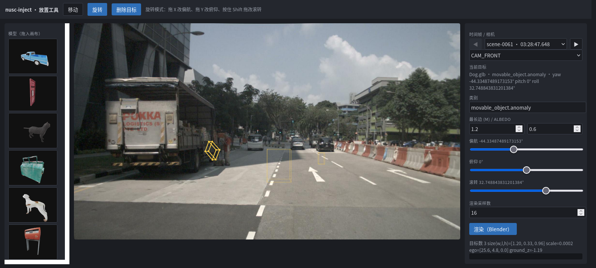
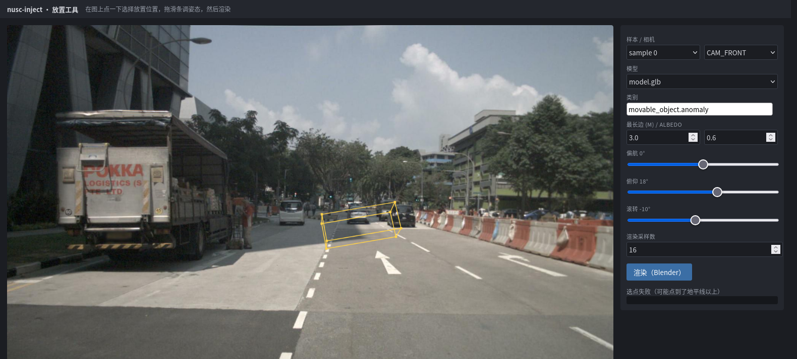

# 交互式放置 UI：使用明细

调位姿时「改 YAML → 跑 30 秒 → 翻图」的循环太慢：一次 P0 要起 Blender，改一个角度就得等一遍。
这个小工具把那个循环压到「拖进来、拖过去、拖一下、点渲染」——**直接操纵**，
不是「点一下选位置 + 拖滑条调姿态 + 下拉选模型」。

```bash
python scripts/annotate_ui.py            # -> http://127.0.0.1:8765
python scripts/annotate_ui.py --port 9000 --open
```

- **零新增依赖**：stdlib `http.server` + 单页 HTML/Canvas，不引入 gradio / streamlit。
- **预览即实际**：线框由 `anchor.build_gt` 生成——和真正渲染走同一条代码路径，
  不存在「预览和结果不一致」的第二套放置数学。
- **渲染走真管线**：点「渲染」跑的是 `pipeline.run_sample`（多目标原生支持），
  Blender 在后台线程，页面轮询进度而不是卡住。
- 启动本身不写任何文件；只有「渲染」会落盘（缩略图是首次用到时的缓存产物）。

---

## 1. 界面



**图 1 · 首屏**：左侧**素材面板**（模型缩略图 + 类目 chip，都可拖）、中间画布、右侧控件。
此时画布上没有目标——目标是拖进来的。



**图 2 · 拖缩略图插入**：把左侧的模型缩略图拖到路面上松手，一个目标就插进去了
（黄色线框）。松手时后端用同一条 `anchor.build_gt` 摆好位置，线框与将来渲染的位置一致。



**图 3 · 多目标**：再拖一个进去就是第二个——两个线框都在画布上，右下角显示「目标数 2」。
侧栏「当前目标」显示的是最后插入/选中的那个（这里是 `demo_barrier.glb`），
其余控件都绑定到它。



**图 4 · 移动模式拖位置**：按住护栏拖到右边。用的是**抓取偏移**——抓住车身的哪个点，
拖动过程中那个点就一直跟着光标，不会跳到车身中心。



**图 5 · 旋转模式拖姿态**：拖 X 改偏航、拖 Y 改俯仰、按住 Shift 拖改滚转。
护栏横跨车道的姿态就是这么拖出来的（图里是偏航 + 滚转叠加后的结果）。


**图 6 · 选中目标**：点中某个线框，它变粗变亮（选中态），侧栏控件切到它。
命中测试用服务端返回的 8 个投影角点取 2D 凸包。



**图 7 · 点天空会被明确拒绝**：射线与估计的地面平面没有交点，信息区给出
「选点失败（可能点到了地平线以上）」，而不是把目标丢到某个错位置上。


**图 8 · 渲染完成**：**两个目标一次渲染**。结果图替换整块画布（点图可退回预览）。
日志里能看到 `objects=2 dropped=-`——被真实场景挡住的目标会被逐个丢弃并报出来，
不会让整次渲染失败。

---

## 2. 操作流程

1. **选时间帧 / 相机**：下拉列出**全部 404 个关键帧**，标签是 `场景 · 时刻`
   （如 `scene-0061 · 03:28:47.648`），可直接跳。旁边 **◀ ▶ 逐帧前进后退**——
   沿 nuScenes 自己的 `prev`/`next` 链走，到场景边界自动禁用（不会悄悄跳进下一场景）。
   换帧会重新载入点云与图像，画布上的目标保持不变、线框重新投影。
2. **拖入目标**：从左侧素材面板把模型缩略图（或类目 chip）拖到画布上松手。
   拖到**已有目标的线框上**则改那个目标的模型/类别；拖到空地则是插入一个新目标。
3. **移动**（默认模式）：拖动目标改位置；点空白处把选中目标放到那里。
4. **旋转**：切到「旋转」模式，拖 X 改偏航、拖 Y 改俯仰、Shift+拖 改滚转。
5. **选中 / 删除**：点线框选中，点「删除目标」移除。
6. **渲染**：实测 16 采样下两个目标约 5–8 秒（其中 Blender 约 4–6 秒），
   采样数调大就更慢更干净。只渲染**视锥内看得到目标**的那几路相机——
   单目标通常只有 `CAM_FRONT`，这是 frustum 裁剪，不是只渲染了一路。

一次可以放**任意多个**目标。跨帧轨迹、落库导出请用 `scripts/run_batch.py`；
这个工具的定位是「先在这里把构图调顺，再把位姿抄进配置」。

---

## 3. 控件对照表

界面上每个控件都对应配置文件里的一个字段——工具本身不发明任何参数：

| 控件 | 默认 / 范围 | 落到配置的字段 | 说明 |
|---|---|---|---|
| 移动 / 旋转 | 移动 | — | 交互模式（不是配置项） |
| 删除目标 | — | — | 移除当前选中的目标 |
| 素材面板 · 模型缩略图 | `assets/models/*.glb`（+ `data/models/` 的生成物） | `model.path` | 拖到画布插入 / 拖到目标上换模型 |
| 素材面板 · 类目 chip | nuScenes 23 个类目 | `model.category` | 拖到画布插入 / 拖到目标上改类目 |
| 时间帧（◀ ▶ + 下拉） | `scene-0061 · 03:28:47.648` | `dataset.sample_index` | 404 个关键帧全列；◀▶ 逐帧走 `prev`/`next`，场景边界禁用 |
| 当前目标 | — | — | 显示选中目标的模型·类目·姿态 |
| 类别 | `movable_object.anomaly` | `model.category` | 完整 nuScenes 类目名 |
| 最长边 (m) | `3.0` | `model.target_max_dim_m` | `scale = 最长边 / 模型最长边`；**新目标继承当前值** |
| albedo | `0.6` | `model.albedo` | LiDAR 强度 `I = k·ρ·max(cosθ,0)`，只影响点云强度 |
| 偏航 | `0`，−180…180° | `placement.yaw_in_ego_deg` | 绕 ego **Z** 轴；也可在旋转模式下拖出来 |
| 俯仰 | `0`，−90…90° | `placement.pitch_in_ego_deg` | 绕 ego **Y** 轴，+ 为前倾 |
| 滚转 | `0`，−90…90° | `placement.roll_in_ego_deg` | 绕 ego **X** 轴，+ 为右倾 |
| 渲染采样数 | `16`，4…512 | `camera_channel.cycles_samples` | Cycles 采样数；截图用小值换速度 |
| 渲染（Blender） | — | — | 起后台任务；按钮在任务期间置灰 |
| 信息区 / 日志区 | — | — | `目标数` / `size`/`scale`/`ego`/`ground_z` + `status`/`all_pass`/`dropped`/输出目录 |

姿态符号约定（ZYX 内旋、右手定则、+pitch 前倾）与配置文件完全一致，
详见 [`model-input.md`](model-input.md) 的「姿态约定」。

---

## 4. 输出

每次渲染写一个 `data/outputs/ui/run_<6位hex>/`，**与 `run_p0.py` 的产物同构**：

```
data/outputs/ui/run_xxxxxx/
├── job.json                 # Blender 任务（几何、相机、采样数）
├── gt.json                  # 单一真值 T_model2global / T_model2lidar
├── spec.json                # 本帧的导出 spec（类目、位姿、size、model_path）
├── lidar/                   # injected.pcd.bin、obj_points_lidar.npy…
├── blender/                 # 每路相机的 RGBA 前景
├── depth/                   # obj/scene 深度图（调试用，体积大头）
├── composite/               # 最终合成图 = 交付物
├── viz/                     # 点云叠加与 BEV
├── validation_report.json   # 与批量运行同一套门禁
└── logs/blender_render.log  # Blender 进程输出（UI 不配 run_p0 的 run.log）
```

**多目标时 `gt.json` 是 list，单目标时是 dict**——`pipeline.run_sample` 的既有行为
（`pipeline.py:127`），本工具不改它。`spec.json` 与 `validation_report.json`
仍是整帧一份。

日志里的 `dropped=[...]` 是被场景完全挡住而丢弃的目标（客户端 id）；
这类丢弃是逐目标的，不会让整次渲染失败。

缩略图缓存在 `data/outputs/ui/thumbs/<模型文件名>/thumb.png`，是生成物、可删
（删了下次打开面板重渲）。模型文件改了缩略图会自动重渲。

不满意就再点一次渲染——旧目录不会自动删除，清理见 [`data-layout.md`](data-layout.md)。

---

## 5. 已知限制

- **缩略图首次生成要等**：每个模型一次 Blender 渲染约 1–5 s（6 个模型首屏最坏 30 s），
  之后读缓存。面板里会先显示占位、图片到位后自然替换。
- **旋转没有 gizmo 环**：用「移动 / 旋转」两种模式 + 拖动，画布保持干净。
  需要精确角度时用滑条（或拖完读信息区的数值）。
- **地面高度是统计估计，不是精确路面**。UI 固定 `ground.search_radius_m = 4.0`、
  `z_percentile = 15`（与 `configs/*.yaml` 的默认一致），即「4 m 邻域内 LiDAR 点 z 的
  15 百分位」。路面有坡度、路缘或低洼时，这个值与目标脚下的实际路面会差。同一姿态
  （俯仰 28°/滚转 −12°）只换点选位置，实测三组：

  - 平路 `ego≈[20,-3]`（**截图用的就是这个点**）：4 m 与 1 m 邻域的估计只差 **6 mm**
    （20 m 处约 0.4 px，肉眼不可见）；
  - 近场 5–6 m：两者差 **4.0–4.4 cm**；
  - 起伏处 `ego≈[14.4,0.3]`：锚点处两者差 4.4 cm，而 `ground_z` 比接触点脚下的路面
    还低 **10 cm**——在 11–14 m 距离上就是 **10–20 px** 的错位，目标会陷进路面。

  想更贴地：点在更平的路面上，或到配置里调 `ground.search_radius_m`。
- **渲染没有接触阴影**。倾斜目标只靠一个轮子/一条边着地，缺少阴影时会显得「离地」——
  那是几何真实（倾斜的 3D 框本来就悬空），不是放置错位。
- **无鉴权、只听 `127.0.0.1`**。不要 `--host 0.0.0.0` 暴露到公网。
- **结果图是整幅合成图**，不像文档配图那样带「目标区域放大内嵌」——需要放大看细节时
  用 `scripts/make_doc_figs.py` 那套逻辑出图。

---

## 6. 截图重建

文档里这 8 张图是**可复现产物**，不是手工截的：

```bash
python scripts/make_ui_screenshots.py      # -> docs/summary/figs/ui_*.png
```

脚本自己拉起 UI 服务和 geckodriver，用 WebDriver 的 HTTP 接口驱动 headless Firefox
（不引入 selenium），派发与真人相同的 pointer / drag 事件：
拖缩略图插入两个目标 → 拖动改位置 → 切旋转模式拖姿态 → 点线框选中 → 点天空看报错 → 渲染。

因为它走的是**真实交互**，所以同时是这个 UI 的**端到端冒烟测试**：
任何一步 JS 报错、预览没返回、缩略图没加载，都会让它卡在 `wait_js` 超时退出。
需要 `geckodriver` 与本机装了 Firefox。

点选像素与拖拽起点都写在脚本里，并注明**为什么选那个点**——地面高度是 4 m 邻域
15 百分位的估计，起伏处会差 10 cm 级；点击要落在目标**框中心**（放置点正好在凸包边界上，
点在不在多边形里不可靠）。改了界面布局或默认值后重跑一次即可。

> 这些截图含 nuScenes 相机图像，属其衍生结果；许可条款见
> [`summary/README.md`](summary/README.md) 的「数据来源与许可」。
