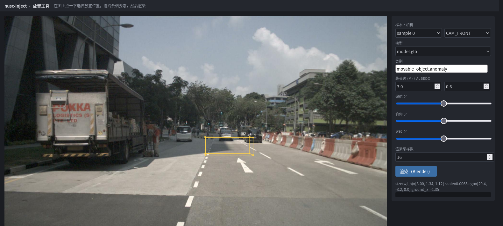

# 交互式放置 UI：使用明细

调位姿时「改 YAML → 跑 30 秒 → 翻图」的循环太慢：一次 P0 要起 Blender，改一个角度就得等一遍。
这个小工具把那个循环压到「点一下、拖一下、看一眼」。

```bash
python scripts/annotate_ui.py            # -> http://127.0.0.1:8765
python scripts/annotate_ui.py --port 9000 --open
```

- **零新增依赖**：stdlib `http.server` + 单页 HTML/Canvas，不引入 gradio / streamlit。
- **预览即实际**：线框由 `anchor.build_gt` 生成——和真正渲染走同一条代码路径，
  不存在「预览和结果不一致」的第二套放置数学。
- **渲染走真管线**：点「渲染」跑的是 `pipeline.run_sample`，Blender 在后台线程，
  页面轮询进度而不是卡住。
- 启动本身不写任何文件；只有「渲染」会落盘。

---

## 1. 界面


**图 1 · 首屏**：左画布是选定样本的相机原图，右侧栏是全部控件。默认载入 `sample 0` 的 `CAM_FRONT`。



**图 2 · 点选后的线框预览**：在路面上点一下，黄线框立刻出现在该位置——那就是渲染后目标会占的位置。


**图 3 · 拖滑条调姿态**：偏航 / 俯仰 / 滚转各一个滑条，拖动时线框实时跟随（这里俯仰 18°、滚转 −10°）。
线框的 12 条边与 8 个角点都来自 `build_gt` 输出的真实 3D 框，不是示意图。


**图 4 · 渲染完成**：结果图替换整块画布（点图可退回预览）。侧栏下方给出
`size(w,l,h)` / `scale` / `ego` 偏移 / `ground_z`，以及这次运行的状态与输出目录。

---

## 2. 操作流程

1. **选样本 / 相机**：样本下拉是 `0 … N` 每 200 个取一个（v1.0-mini 只有 404 个，所以是全量）。
2. **选模型**：下拉列出 `data/models/*.glb`，`model.glb` 排第一（其余是演示模型与轴向对照模型）。
3. **点图选位置**：从像素反投射一条射线，与**估计的地面平面**求交，得到 ego 系偏移
   （x 前、y 左、z 上）。点天空（射线与地面无交点）会明确报错而不是给个错位置。
4. **拖滑条调姿态**：偏航 / 俯仰 / 滚转，见下方控件表。
5. **点「渲染」**：低采样下十几秒量级；采样数调大就更慢更干净。

一次只能放**一个**目标。多目标、跨帧轨迹、落库导出请用 `scripts/run_batch.py`；
这个工具的定位是「先在这里把位姿调顺，再把数值抄进配置」。

---

## 3. 控件对照表

界面上每个控件都对应配置文件里的一个字段——工具本身不发明任何参数：

| 控件 | 默认 / 范围 | 落到配置的字段 | 说明 |
|---|---|---|---|
| 样本 | `sample 0` | `dataset.sample_index` | 换样本会重新载入点云与图像 |
| 相机 | `CAM_FRONT` | 渲染哪一路 | 只影响输出与结果图，不影响放置 |
| 模型 | `model.glb` | `model.path` | `data/models/*.glb` |
| 类别 | `movable_object.anomaly` | `model.category` | 完整 nuScenes 类目名 |
| 最长边 (m) | `3.0` | `model.target_max_dim_m` | `scale = 最长边 / 模型最长边` |
| albedo | `0.6` | `model.albedo` | LiDAR 强度 `I = k·ρ·max(cosθ,0)`，只影响点云强度 |
| 偏航 | `0`，−180…180° | `placement.yaw_in_ego_deg` | 绕 ego **Z** 轴 |
| 俯仰 | `0`，−90…90° | `placement.pitch_in_ego_deg` | 绕 ego **Y** 轴，+ 为前倾 |
| 滚转 | `0`，−90…90° | `placement.roll_in_ego_deg` | 绕 ego **X** 轴，+ 为右倾 |
| 渲染采样数 | `16`，4…512 | `camera_channel.cycles_samples` | Cycles 采样数；截图用小值换速度 |
| 渲染（Blender） | — | — | 起后台任务；按钮在任务期间置灰 |
| 信息区 / 日志区 | — | — | `size`/`scale`/`ego`/`ground_z` + `status`/`all_pass`/输出目录 |

姿态符号约定（ZYX 内旋、右手定则、+pitch 前倾）与配置文件完全一致，
详见 [`model-input.md`](model-input.md) 的「姿态约定」。

---

## 4. 输出

每次渲染写一个 `data/outputs/ui/run_<6位hex>/`，**与 `run_p0.py` 的产物同构**，
所以可以直接用同一套方式检查：

```
data/outputs/ui/run_xxxxxx/
├── job.json                 # Blender 任务（几何、相机、采样数）
├── gt.json                  # 单一真值 T_model2global / T_model2lidar
├── spec.json                # 本帧的导出 spec（类目、位姿、size、model_path）
├── lidar/                   # injected.pcd.bin、obj_points_lidar.npy…
├── blender/                 # 每路相机的 RGBA 前景
├── depth/                   # obj/scene 深度图（调试用，体积大头）
├── composite/               # 最终合成图 = 交付物
├── viz/                     # 点云叠加与 BEV
├── validation_report.json   # 与批量运行同一套门禁
└── logs/run.log
```

不满意就再点一次渲染——旧目录不会自动删除，清理见 [`data-layout.md`](data-layout.md)。

---

## 5. 已知限制

- **地面高度是统计估计，不是精确路面**。UI 固定 `ground.search_radius_m = 4.0`、
  `z_percentile = 15`（与 `configs/*.yaml` 的默认一致），即「4 m 邻域内 LiDAR 点 z 的
  15 百分位」。路面有坡度、路缘或低洼时，这个值与目标脚下的实际路面可差 10 cm 级。
  实测：同一姿态（俯仰 28°/滚转 −12°）只换点选位置，目标底边与路面的像素差在
  **2–20 px** 之间；平路上 4 m 与 1 m 邻域的估计只差 6 mm，起伏处差 4–18 cm。
  想更贴地：点在更平的路面上，或到配置里调 `ground.search_radius_m`。
- **渲染没有接触阴影**。倾斜目标只靠一个轮子/一条边着地，缺少阴影时会显得「离地」——
  那是几何真实（倾斜的 3D 框本来就悬空），不是放置错位。
- **一次一个目标、一帧**。多目标与跨帧轨迹见 `run_batch.py`。
- **无鉴权、只听 `127.0.0.1`**。不要 `--host 0.0.0.0` 暴露到公网。
- **结果图是整幅合成图**，不像文档配图那样带「目标区域放大内嵌」——需要放大看细节时
  用 `scripts/make_doc_figs.py` 那套逻辑出图。

---

## 6. 截图重建

文档里这 4 张图是**可复现产物**，不是手工截的：

```bash
python scripts/make_ui_screenshots.py      # -> docs/summary/figs/ui_*.png
```

脚本自己拉起 UI 服务和 geckodriver，用 WebDriver 的 HTTP 接口驱动 headless Firefox
（不引入 selenium）：载入首屏 → 点选 → 拖滑条 → 渲染 → 逐张截图。
需要 `geckodriver` 与本机装了 Firefox。

点选像素与滑条数值都写在脚本里，并注明**为什么选那个点**——该处 4 m 与 1 m 邻域的
地面估计只差 6 mm，换成起伏处的点目标就会陷进路面。改了界面布局或默认值后重跑一次即可。

> 这些截图含 nuScenes 相机图像，属其衍生结果；许可条款见
> [`summary/README.md`](summary/README.md) 的「数据来源与许可」。
