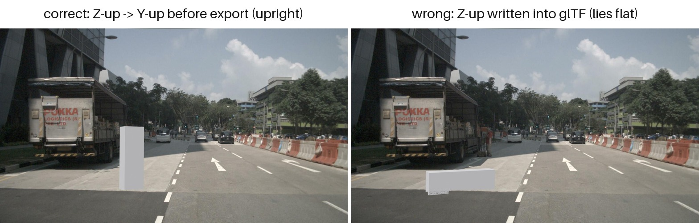
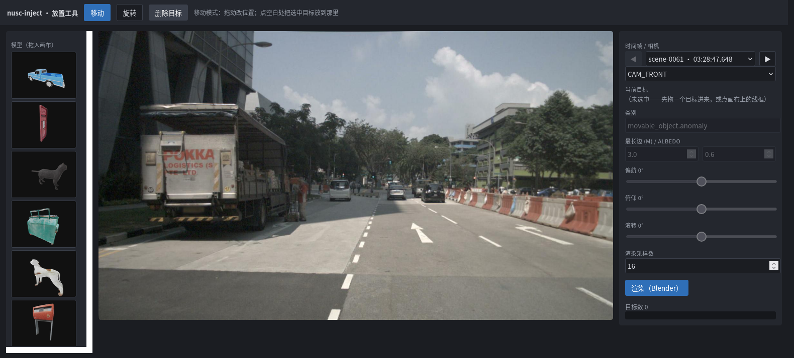
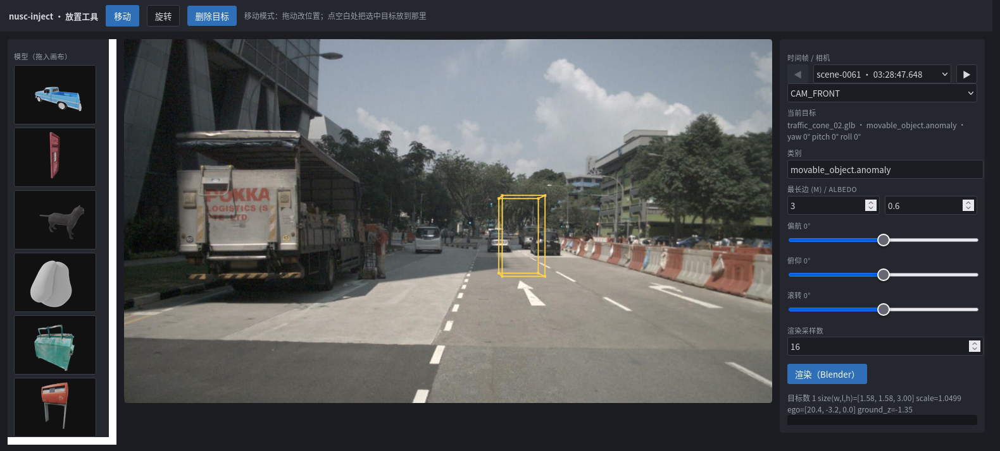
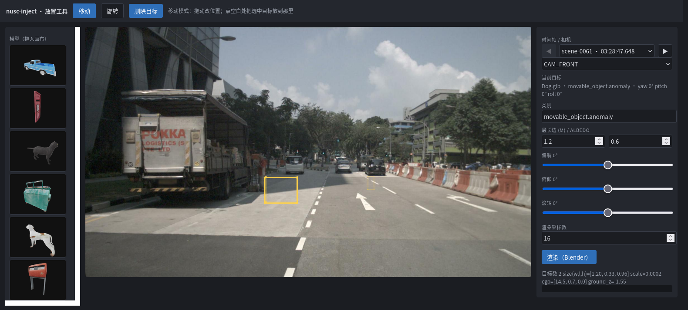
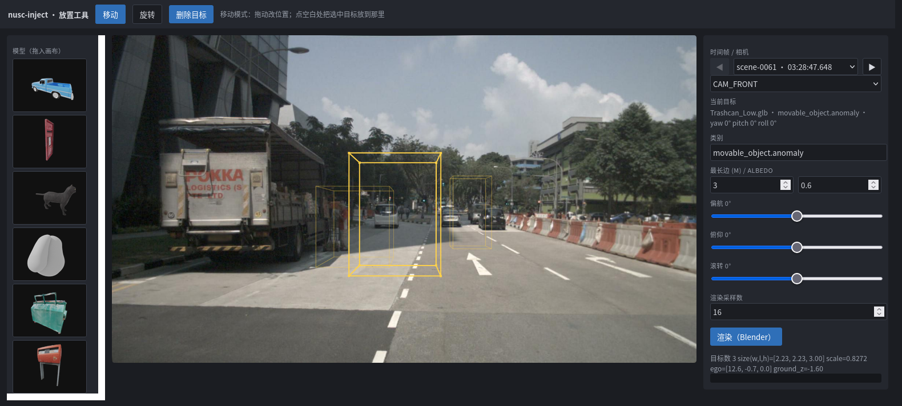
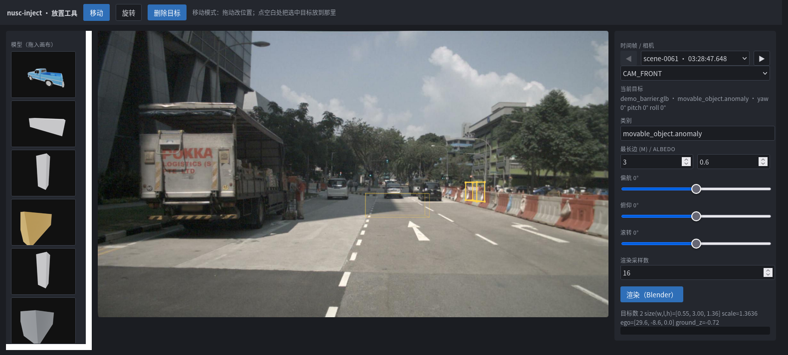
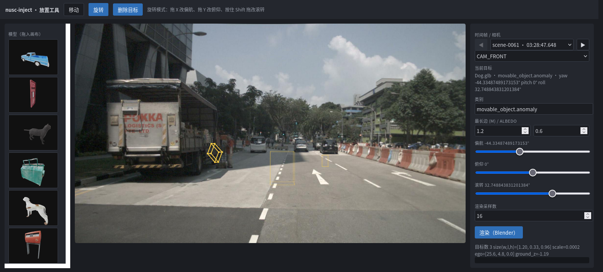
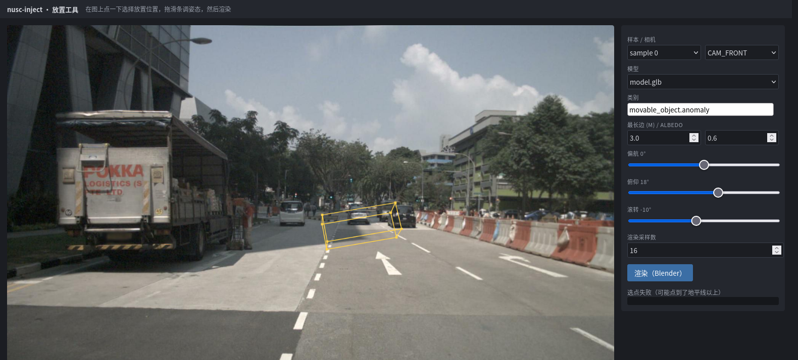

# 参考手册

本页是三份详细参考的合并，按「模型 → 目录 → 工具」排列：

| 部分 | 内容 |
|---|---|
| [第一部分](#第一部分--第三方目标输入格式与参数) | 模型文件格式、材质两通道处理、模型级/放置参数、常见坑 |
| [第二部分](#第二部分--data-目录内容用途与产生者) | `data/` 每个目录的内容、产生者、体积与清理方式 |
| [第三部分](#第三部分--交互式放置-ui使用明细) | 放置 UI 的界面、流程、控件对照、输出与限制 |

常用操作（环境搭建、运行、验收）见 [README](../README.md)；
各次实验的原始输出见 [measurements.md](measurements.md)；
逐图说明见 [summary/README.md](summary/README.md)。

---

# 第一部分 · 第三方目标：输入格式与参数
本文说明「往 nuScenes 里注入什么目标、用什么格式喂进来、有哪些参数可调」。
参数默认值见 `configs/base.yaml`，单/批量差异见 `configs/p0.yaml`、`configs/batch.yaml`。

---

## 1. 支持的文件格式

| 后缀 | Blender 导入器 | 轴向处理 | 材质/贴图来源 |
|---|---|---|---|
| `.glb` | `import_scene.gltf` | Y-up → Z-up 自动换算 | 文件内嵌（PBR + 贴图） |
| `.gltf` | 同上 | 同上 | **外部** `.bin` / 贴图，须与 `.gltf` 同目录且路径正确 |
| `.obj` | `import_scene.obj` | 同上（导入器 `axis_up='Y'`） | 依赖同名 `.mtl` + 外部贴图文件 |
| `.fbx` | `import_scene.fbx` | 同上 | 内嵌或外部贴图 |
| `.ply` | `wm.ply_import` | **不换算**（约定 Z-up） | 顶点色，无 PBR |

`.glb` 是唯一「单文件自包含」的格式，**推荐优先用它**——`.gltf`/`.obj` 一旦贴图路径
失效，模型会以无纹理的默认灰白材质渲染，而且不会报错。

### 坐标与单位

- 单位按 **米** 解释，不做单位换算。一个 1000 单位的 OBJ 会被当成 1000 m 的巨物
  （`validation.max_size_m` 会在校验阶段拒绝它）。
- Blender 世界系 ≡ nuScenes 全局系（右手、z-up）。Y-up 格式由 `mesh_points._to_blender_frame`
  统一做 `(x, y, z) → (x, -z, y)`，**不要自己在模型里预先旋转**，否则会被转两次。
- 运行时有一道**形状敏感漂移守卫**：比对 trimesh 与 Blender 导入后的 bbox、表面积、
  面积加权质心。任一不一致即 FATAL —— 这能抓住「轴向又转了一次」这类问题，
  包括对称包围盒掩盖的那种。

注意漂移守卫**只保证两侧一致，不保证符合你的意图**。下面两张图是同一个网格、
同一个位姿，只有导出时的轴向处理不同：



*左：导出前做了 Z-up → Y-up 转换，行人正常站立（`size=[0.55, 0.45, 1.75]`）；
右：把 Z-up 坐标直接写进 Y-up 的 glTF，两侧仍然一致、校验也通过，
但模型躺平了（`size=[1.75, 0.45, 0.55]`，高度只剩 0.55 m）。*

**所以轴向正确性最终靠你保证**：模型自带坐标必须符合 glTF 的 Y-up 规范，
`mesh_points` 只会按规范转一次。

---

## 2. 材质：两通道分别怎么处理

这是最容易误解的一点：**两个通道对「材质」的用法完全不同。**

### 相机通道 —— 原样透传，代码不编辑任何材质

模型文件里带的材质由 Blender **原样导入**，Cycles 直接渲染。仓库**没有任何材质编辑代码**
（不创建/替换/调参 material 节点）。所以：

- glTF 的 PBR（base color / metallic / roughness / normal / emissive / alpha blend）全部生效；
- 光照是**固定的**：白色世界背景（强度 0.6）+ 一盏太阳灯（energy 3.0，50°/30°）。
  没有逐次运行的光照随机化——遮挡判定与内参自检需要可复现的图像；
- `film_transparent=True`，输出 RGBA PNG（alpha 即目标轮廓）。

**由此带来两条实务约束**：

1. **不透明目标才可靠**。半透明材质（玻璃、纱）会产生部分 alpha，而合成阶段
   只在 `alpha > alpha_threshold`（默认 0.05）的像素上做遮挡判定，半透明边缘会出现
   判定不稳定。
2. **亮度靠材质本身**。想调整目标在图像里的明暗，只能改模型材质，配置里没有对应参数。

### LiDAR 通道 —— 只有一个标量反照率

点云强度用 Lambertian 模型计算：

```
I = clip(k · ρ · max(−d·n, 0), 0, 255)
```

- `ρ` = `albedo`（漫反射率），`k` = `intensity_gain_k`（增益）
- `d` 是点到传感器的单位方向，`n` 是表面法线，所以背向点自然为 0
- 结果只用到模型的**几何**（采样点 + 法线），**不读材质**

也就是说，LiDAR 侧「材质」退化成一个数字：**`albedo`**。没有金属度、粗糙度、
波长相关反射率、透射等概念。想让点云更亮就调 `albedo` 或 `intensity_gain_k`。

两个可直接用的关系（实测见 `docs/measurements.md` M10）：

- **迎面（法线对着传感器）的峰值强度 = `k · ρ`**，例如 `k=200, albedo=0.7` → 140；
- **强度与距离无关**：模型里没有 `1/r²` 衰减项。真实 LiDAR 的回波强度会随距离下降，
  所以注入目标在远处会比真实目标偏亮。这是已知近似。

> ⚠️ **两通道的明暗不会自动一致**：图像亮度来自文件材质，点云强度来自 `albedo`。
> 两者需要人工对齐。例如深色车漆的模型（图像暗）应配较小的 `albedo`，
> 否则会出现「图像里是黑车、点云里却很亮」的违和。

### 关于「材质种类」

代码层面**没有材质种类的概念**，也没有预设材质库——分类完全取决于你喂进来的模型。
若需要不同材质的效果差异，做法是准备不同的模型文件（或同一模型的不同材质版本），
在模型池里并列，用 LiDAR 侧的 `albedo` 对齐点云强度。

---

## 3. 模型级参数

放在 `configs/p0.yaml` 的 `model:`（单目标）或 `configs/batch.yaml` 的 `models:`（模型池，列表）。

| 参数 | 类型 | 默认 | 说明 |
|---|---|---|---|
| `path` | str | **必填** | 模型路径，相对仓库根目录（`load_config` 会转绝对路径） |
| `category` | str | 继承 `annotation.category_name` | 落库用的 **nuScenes 类目名**，如 `movable_object.anomaly`、`movable_object.barrier`。同一 `track` 内必须一致；不同目标可不同类目 || `target_max_dim_m` | float \| [lo,hi] | `3.0` | 缩放后**最长包围盒边**的目标长度（米）。批量模式可写区间随机采样 |
| `scale` | float \| null | `null` | 显式**均匀**缩放。设了就**覆盖** `target_max_dim_m`。不提供非均匀缩放 |
| `albedo` | float | `0.6`（代码缺省 0.5） | LiDAR 漫反射率 ρ，越大点云越亮 |
| `intensity_gain_k` | float | `200.0` | LiDAR 强度增益 k，与 `albedo` 相乘后截断到 0–255 |

`path`、`target_max_dim_m`、`scale` 三者关系：

```
scale 显式给出      → 用 scale（构造时会对 ≤0 / 非有限值报错）
否则                → scale = target_max_dim_m / 模型最长边
```

模型最长边为 0（退化网格）、`target_max_dim_m ≤ 0`、或把区间形式传给非批量脚本，
都会**显式报错**而不是产生 NaN 变换。

> **用已有类目名的注意点**：`category` 可以填 nuScenes 里**已存在**的类目
> （如 `human.pedestrian.adult`），导出时会复用该 category token，注入目标与真实同类
> 目标**在类目上不可区分**——这是有意为之（相当于往既有类别里补样本），但下游若要
> 只取注入目标，必须按 token 过滤而不是按类目过滤：
>
> ```python
> import json
> rep = json.load(open("data/exports/nuscenes-od-p0/export_report.json"))
> injected = set(rep["export"]["instance_tokens"])   # 本次注入的 instance
> ```
>
> `annotation.verify_export` 因此走 token 选择；早期版本按类目筛选，复用已有类目时
> 会把该类的**全部真实标注**都算进去（实测误报 7090 条）。

---

## 4. 放置参数

### 单目标（`configs/p0.yaml` 的 `placement:`）

| 参数 | 默认 | 说明 |
|---|---|---|
| `offset_in_ego` | — | `[前, 左, 上]`，单位米，**ego 系** |
| `yaw_in_ego_deg` | `0` | 偏航，绕 ego **Z** 轴（正 = 逆时针俯视） |
| `pitch_in_ego_deg` | `0` | 俯仰，绕 ego **Y** 轴 |
| `roll_in_ego_deg` | `0` | 滚转，绕 ego **X** 轴 |
| `ground.search_radius_m` | `4.0` | 在该半径内找地面点估计高度 |
| `ground.z_percentile` | `15.0` | 取该分位数作为地面 z |

**姿态约定**：ZYX 内旋欧拉角 —— 先绕 Z 偏航，再绕**新的** Y 俯仰，最后绕**新的** X 滚转
（等价于 `R = Rz(yaw)·Ry(pitch)·Rx(roll)`）。符号按右手定则：

| 正角度 | 效果 |
|---|---|
| `yaw` + | 逆时针俯视旋转 |
| `pitch` + | 物体顶部向 **+X（前）** 倾倒，即「前倾 / 低头」 |
| `roll` + | 物体顶部向 **−Y（右）** 倾倒，即「右倾」 |

> **落地方式**：物体按**网格最低顶点**贴地，不是按包围盒角点。网格只在少数点接触
> 自己的包围盒（车辆靠轮胎与保险杠），倾斜后包围盒的最低角往往落在没有几何的空处，
> 按角点贴地会让整个模型悬空——实测 `pitch 28°/roll −12°` 悬空 20.7 cm，
> 连 yaw-only 也有 1.58 cm（见 [`measurements.md`](measurements.md) M11）。
> `anchor._ground_drop` 从网格顶点求旋转后的最低点，把放置锚点相应抬高/降低；
> `build_gt` 的 `model_verts` 因此是必填参数（传网格顶点，不是角点）。
> 注意真实 `LIDAR_TOP` 安装带约 1.4° 俯仰，所以即使 yaw-only 该修正量也不为 0。

> 为什么是 **ego 系**而不是 lidar 系：nuScenes 的 `LIDAR_TOP` 相对 ego 约有 −90° 偏航安装旋转
> （实际标定还带约 1.4° 的俯仰/滚转），直接用 lidar 系会让人对「前方」产生错觉。
> `anchor.py` 内部按 **矩阵合成**换算：`R_lidar = R_l2e^T · R_ego`——
> 不能对角度做标量相减，因为绕 X/Y 的旋转与安装偏航不可交换。

### 批量（`configs/batch.yaml` 的 `objects:`）

| 参数 | 默认 | 说明 |
|---|---|---|
| `count` | `2` | 每帧目标数（tracking 模式下为每场景轨迹数） |
| `forward_range_m` | `[8,30]` | ego 系前向随机范围 |
| `lateral_range_m` | `[-4,4]` | ego 系横向随机范围 |
| `yaw_in_ego_deg_range` | `[0,360]` | 偏航随机范围 |
| `pitch_in_ego_deg_range` | `[0,0]` | 俯仰随机范围（默认固定 0） |
| `roll_in_ego_deg_range` | `[0,0]` | 滚转随机范围（默认固定 0） |
| `min_spacing_m` | `6.0` | legacy 模式目标间最小间距 |
| `seed` | `42` | 确定性随机种子 |
| `tracking.enabled` | `true` | 跨帧轨迹模式（世界系静止目标 + prev/next 链） |
| `tracking.length` | `[3,8]` | 每条轨迹帧数 |
| `tracking.forward_range_m` | `[12,35]` | 轨迹起始的放置范围 |

被场景**完全遮挡**的目标会被丢弃（记在 `specs.json` 的 `summary.dropped`），
不会让整帧失败；只有全部目标都不可见或校验不过才跳过该帧。

---

## 5. 其他相关参数（影响目标外观/数量）

| 配置块 | 参数 | 默认 | 对目标的影响 |
|---|---|---|---|
| `mesh_points` | `n_dense` | `300000` | 表面采样点数——决定点云密度与深度缓冲精度 |
| | `n_lidar` | `12000` | 单目标注入点数上限 |
| `lidar_channel` | `out_format` | `n5` | `n5` 原生 (N,5)；`n4` KITTI 风格 |
| | `range_max_m` | `80` | 超出该距离的目标点丢弃 |
| `camera_channel` | `cycles_samples` | `64` | Cycles 采样数，越高越干净也越慢 |
| | `engine` / `cycles_device` | `CYCLES` / `CPU` | 传给 Blender；有 GPU 可设 `GPU` |
| `composite` | `alpha_threshold` | `0.05` | 低于此 alpha 的像素不参与合成 |
| | `depth_margin_m` / `depth_margin_rel` | `0.2` / `0.02` | 深度容差（常数项 + 距离比例项） |
| `validation` | `min_size_m` / `max_size_m` | `0.05` / `40` | 目标最长边合理区间，超界校验失败 |
| | `min_alpha_px` | `500` | 轮廓小于该像素数的相机整体跳过 |

---

## 6. 常见坑

| 现象 | 原因 | 处理 |
|---|---|---|
| 模型渲染成灰白、无纹理 | `.gltf`/`.obj` 的外部贴图路径失效 | 改用 `.glb`，或把贴图放到模型同目录 |
| `FATAL: trimesh/Blender model-frame mismatch` | 轴向被转了两次（模型内已旋转 + 代码又转） | 模型保持原始轴向，交给代码换算 |
| `FATAL: ... surface area mismatch` | 导入后几何被改变（如非均匀缩放烘焙进模型） | 导出时保持均匀缩放 |
| `ValueError: model bbox has zero extent` | 空网格 / 全共面网格 | 换模型 |
| `ValueError: scale must be a finite positive number` | `scale` ≤ 0 或 NaN | 检查配置或改用 `target_max_dim_m` |
| 目标整体不出现在点云 | 被场景完全遮挡（正常）或超出 `range_max_m` | 看 `specs.json` 的 `summary.dropped` |
| 点云很暗 / 很亮 | `albedo` 与材质不匹配 | 调 `albedo`（图像亮度需改模型材质） |
| 目标比预期大/小 | 误以为按体积或高度缩放 | 缩放基准是**最长包围盒边** |

---

## 7. 最小可运行示例

```bash
# 1) 放模型
cp /path/to/your_model.glb assets/models/

# 2) 改 configs/p0.yaml
#    model:
#      path: assets/models/your_model.glb
#      category: movable_object.anomaly
#      target_max_dim_m: 3.0
#      albedo: 0.45
#      intensity_gain_k: 200.0

# 3) 跑单样本
python scripts/run_p0.py --config configs/p0.yaml --run-id my_object
```

产物在 `data/outputs/p0/my_object/`：`gt.json`（真值）、`lidar/injected.pcd.bin`、
`blender/CAM_*.png`（RGBA 前景）、`composite/CAM_*.jpg`（合成图）、
`viz/*_overlay.jpg`（叠加可视化）、`validation_report.json`。

批量注入多个不同类目/材质的目标：把多个条目并列在 `configs/batch.yaml` 的 `models:` 下，
每个条目给不同的 `path` / `category` / `albedo`。

---

# 第二部分 · data/ 目录：内容、用途与产生者
`data/` 下**全部是运行期数据**，不进版本控制（`.gitignore` 已排除）。克隆仓库后该目录不存在：
要么按 §1 自行准备输入，要么由管线生成。

> **入库的输入模型在 [`assets/models/`](../assets/models/README.md)**（12 个 `.glb`，约 38 MB，
> 含许可说明），不在 `data/` 里。`data/models/` 只剩生成物（演示盒子、轴向对照模型）。

本机当前状态（供参照，数字会随运行增减）：

```
data/                 2.8G
├── nuscenes          0      → 软链到仓库外部的 nuScenes 数据集
├── models/          28K     生成物：demo_*.glb / axis_*.glb（真实模型见 assets/models/）
├── outputs/        2.7G     运行产物（p0 出图素材 2.6G + UI 渲染与缩略图）
└── exports/        144M     nuScenes 格式导出（交付物）
```

---

## 1. 目录职责一览

| 路径 | 内容 | 谁产生 | 入库 | 可删 |
|---|---|---|---|---|
| `nuscenes/` | nuScenes 原始数据集（`v1.0-mini/` 13 张表 + `samples/` + `sweeps/` + `maps/`） | **你提供**（官网下载，CC BY-NC-SA 4.0） | 否 | 否，删了跑不了 |
| `models/` | **生成物**：`scripts/make_demo_models.py` 的演示盒子、`make_doc_fixtures.py` 的轴向对照模型 | 上述两个脚本 | 否 | 可，脚本重生成 |
| `outputs/p0/<run_id>/` | 单次运行的全部中间产物与校验报告 | `run_p0.py` / `run_batch.py` | 否 | 可，重跑即得 |
| `outputs/ui/run_<hex>/` | 放置 UI 每次「渲染」的一次运行（结构与 p0 同构） | `scripts/annotate_ui.py` | 否 | 可，再点一次渲染即得 |
| `outputs/ui/thumbs/<模型名>/` | 放置 UI 的模型缩略图（RGBA 透明底，256²）+ 该次 Blender 的 job.json | `annotate_ui.py` 的 `/api/thumb` | 否 | 可，下次打开面板重渲（约 1–5 s/模型） |
| `exports/<name>/` | 标准 nuScenes 格式数据集，devkit 可直接加载 | `run_batch.py` 的导出阶段 | 否 | 谨慎，见 §5 |

`nuscenes/` 建议用软链指到仓库外（数据集很大且不该混进工程目录）：

```bash
ln -s /path/to/nuScenes data/nuscenes
```

---

## 2. 数据流

```
nuScenes 原始数据 ─┐
                   ├─→ Step1 锚点（gt.json）─→ Step2 LiDAR ─┐
第三方模型 ────────┘                    └─→ Step3 相机  ─┤
                                                          ├─→ Step4 合成 ─→ Step6 校验
                                                          │                   ↓
                                                          └─────────────→ Step5 导出 specs.json
                                                                                    ↓
                                                                    data/exports/<name>/
```

`data/outputs/` 是**过程**，`data/exports/` 是**产物**。前者可随时丢弃，后者是要交付的数据集。

---

## 3. 一次运行产物（`data/outputs/p0/<run_id>/`）

单目标运行把文件平铺在 run 目录下；批量与轨迹模式每帧一层：

```
data/outputs/p0/<run_id>/
├── gt.json                     单目标
├── sample_0000/                批量（legacy）
│   └── …（下表文件）
├── scene-0061/f018/            轨迹模式
│   └── …（下表文件）
├── specs.json                  所有帧的 Step-5 导出规格（批量/轨迹模式）
└── batch.log                   批量运行日志
```

单帧目录内：

| 文件 | 内容 | 典型体积 | 用于 |
|---|---|---|---|
| `gt.json` | 单一 3D 真值：`translation/size/rotation` + `T_model2global` / `T_model2lidar` / `T_lidar2global` | 4K | 两通道的唯一输入 |
| `lidar/injected.pcd.bin` | 注入后的点云，原生 (N,5) | 0.7 MB | **交付物**：被导出的点云 |
| `lidar/obj_points_lidar.npy` | 存活的物体点 (M,5) | 小 | 校验与可视化 |
| `lidar/obj_mask.npy` / `obj_ids.npy` | 哪些行是注入点、属于第几个目标 | 小 | 校验与可视化 |
| `blender/CAM_*.png` | Blender 渲染的 RGBA 前景 | 0.6 MB/路 | Step 4 的输入 |
| `blender/result.json` | 每路相机的内参自检误差与遮挡体 bbox 对账 | 小 | 漂移守卫 |
| `composite/CAM_*.jpg` | 合成后的图像 | 0.2 MB/路 | **交付物**：被导出的图像 |
| `depth/CAM_*_obj_depth.npy` | 物体深度缓冲 | **11 MB/路** | 仅调试，可删 |
| `depth/CAM_*_scene_depth.npy` | 场景深度缓冲 | **11 MB/路** | 仅调试，可删 |
| `viz/CAM_*_overlay.jpg` | 注入点投影回图像 | 0.2 MB/路 | 观察一致性 |
| `viz/lidar_bev.png` | LiDAR 俯视图，目标标红 | 0.5 MB | 观察位置 |
| `validation_report.json` | Step-6 五项校验明细 | 8K | **判断该帧是否合格** |
| `job.json` | 发给 Blender 的完整任务（含相机内外参） | 小 | 复现/排查 |
| `spec.json` | 该帧的 Step-5 导出规格（标注行 + 替换文件映射） | 小 | 导出输入 |
| `logs/run.log` / `logs/blender_render.log` | 运行与渲染日志 | 小 | 排查失败 |

> **`depth/*.npy` 是体积大头**：每路相机 22 MB，6 路全渲染就是 132 MB/帧。
> 它们只用于事后分析遮挡判定，删除不影响任何交付物。

---

## 4. 按通道看产物的归属

| 通道 | 产生 | 最终去向 |
|---|---|---|
| LiDAR | `lidar/injected.pcd.bin` | 实拷进 `exports/…/samples/LIDAR_TOP/` |
| 相机 | `composite/CAM_*.jpg` | 实拷进 `exports/…/samples/CAM_*/` |
| 标注 | `spec.json` → `specs.json` | 汇总成 `exports/…/v1.0-mini/sample_annotation.json` 等四张表 |

---

## 5. 导出目录（`data/exports/<name>/`）

```
nuscenes-od-p0/
├── v1.0-mini/          35M   13 张表 = 原表 + 追加的 category/attribute/instance/sample_annotation
├── samples/           110M   4670 个软链（原文件）+ 178 个实拷（被注入的文件）
├── sweeps/            软链    未改动，指向原数据集
├── maps/              软链    同上
├── export_report.json  9K    导出统计 + devkit 校验结果
└── specs.json         120K   逐帧逐目标的来源清单（位姿/尺寸/类目/模型路径/轨道 key）
```

**软链策略**：`samples/` 里绝大部分是指回原数据集的软链，只有**被注入替换过的**文件
（点云 + 合成图，共 178 个）是真实拷贝。所以导出目录不大却能独立被 devkit 加载——
前提是**原数据集不能删**，软链依赖它。

> ⚠️ `export_dataset` 开头会 `rmtree(export_root)` 重建整个导出目录。测试导出请用
> 独立的 `export_dir`，否则会摧毁成品。

**`specs.json` 是数据集的来源凭证**：它能重建导出（`--export-only`），也是"这批目标分别是
什么、放在哪"的唯一记录。

它由 `export_dataset` **自动写入导出根目录**——因为导出目录每次都会 `rmtree` 重建，
清单若只存在运行目录里，一次重导出就会把唯一的来源记录抹掉（确实发生过）。所以不要再手工
拷，也别把它当成"运行目录的东西"随手删。

---

## 6. 清理建议

| 想省空间 | 做法 | 省下 |
|---|---|---|
| 清掉 UI 缩略图缓存 | 删 `data/outputs/ui/thumbs/` | 约 220 KB，下次打开面板重渲 |
| 只要交付物 | 删 `data/outputs/p0/*/depth/` | 每帧约 22 MB × 相机数 |
| 只是想清掉 UI 试拍 | 删 `data/outputs/ui/*` | 每次渲染约 25 MB，缩略图约 220 KB |
| 导出已完成后 | 删整个 `data/outputs/p0/`——`specs.json` 与全部交付物都在 `exports/` 里 | 批量运行约 2.3 GB |
| 只保留合格帧 | 按 `validation_report.json` 的 `all_pass` 筛 | 视失败率 |
| 换机器/归档 | 只需 `data/exports/<name>/` + `specs.json`（原数据集除外） | — |

**不要删**：`data/nuscenes/`（导出目录的软链依赖它）、`data/exports/<name>/specs.json`。

**已清空的状态下如何重建**（三者都脚本化，没有一次性手工产物）：

| 想恢复 | 命令 | 耗时 |
|---|---|---|
| 出图素材（8 个 fixture） | `python scripts/make_doc_fixtures.py` | ~4 min |
| 文档配图（fig1–fig6） | `python scripts/make_doc_figs.py …`（命令由上一行脚本打印） | ~30 s |
| UI 界面截图（ui_*.png） | `python scripts/make_ui_screenshots.py`（需 geckodriver + Firefox） | ~1 min |
| 批量运行 + 导出 | `python scripts/run_batch.py --config configs/batch.yaml` | ~6 min |
| 仅重导出 | 把 `exports/<name>/specs.json` 拷回任意运行目录，跑 `--export-only` | ~10 s |

---

# 第三部分 · 交互式放置 UI：使用明细
调位姿时「改 YAML → 跑 30 秒 → 翻图」的循环太慢：一次 P0 要起 Blender，改一个角度就得等一遍。
这个小工具把那个循环压到「拖进来、拖过去、拖一下、点渲染」——**直接操纵**，
不是「点一下选位置 + 拖滑条调姿态 + 下拉选模型」。

```bash
python scripts/annotate_ui.py            # -> http://127.0.0.1:8765
python scripts/annotate_ui.py --port 9000 --open
```

- **零新增依赖**：stdlib `http.server` + 单页 HTML/Canvas，不引入 gradio / streamlit。
- **预览即实际**：线框由 `anchor.build_gt` 生成——和真正渲染走同一条代码路径，
  不存在「预览和结果不一致」的第二套放置数学。
- **渲染走真管线**：点「渲染」跑的是 `pipeline.run_sample`（多目标原生支持），
  Blender 在后台线程，页面轮询进度而不是卡住。
- 启动本身不写任何文件；只有「渲染」会落盘（缩略图是首次用到时的缓存产物）。

---

## 1. 界面



**图 1 · 首屏**：左侧**素材面板**（12 个入库模型的缩略图 + 23 个类目 chip，都可拖）、
中间画布、右侧控件。此时画布上没有目标——目标是拖进来的。



**图 2 · 拖缩略图插入**：把左侧的交通锥缩略图拖到路面上松手，一个目标就插进去了
（黄色线框）。松手时后端用同一条 `anchor.build_gt` 摆好位置，线框与将来渲染的位置一致。



**图 3 · 多目标**：再拖一只狗进去——两个**不同类别**的线框同屏，右下角显示「目标数 2」。
侧栏「当前目标」显示最后插入/选中的那个，其余控件都绑定到它。



**图 4 · 三个类别同框**：交通锥（`movable_object.trafficcone`）+ 狗（`animal`）+
垃圾桶（`movable_object.pushable_pullable`）——三个真实模型、三个类目，各自独立位姿与
`target_max_dim_m`，一次渲染全部。



**图 5 · 移动模式拖位置**：按住狗拖到右边。用的是**抓取偏移**——抓住身体的哪个点，
拖动过程中那个点就一直跟着光标，不会跳到身体中心。



**图 6 · 旋转模式拖姿态**：拖 X 改偏航、拖 Y 改俯仰、按住 Shift 拖改滚转。
狗的朝向就是这么拖出来的（图里是偏航 + 滚转叠加后的结果）。


**图 7 · 选中目标**：点中某个线框，它变粗变亮（选中态），侧栏控件切到它。
命中测试用服务端返回的 8 个投影角点取 2D 凸包。



**图 8 · 点天空会被明确拒绝**：射线与估计的地面平面没有交点，信息区给出
「选点失败（可能点到了地平线以上）」，而不是把目标丢到某个错位置上。


**图 9 · 渲染完成**：**三个目标一次渲染**。结果图替换整块画布（点图可退回预览）。
日志里能看到 `objects=3 dropped=-`——被真实场景挡住的目标会被逐个丢弃并报出来，
不会让整次渲染失败。

---

## 2. 操作流程

1. **选时间帧 / 相机**：下拉列出**全部 404 个关键帧**，标签是 `场景 · 时刻`
   （如 `scene-0061 · 03:28:47.648`），可直接跳。旁边 **◀ ▶ 逐帧前进后退**——
   沿 nuScenes 自己的 `prev`/`next` 链走，到场景边界自动禁用（不会悄悄跳进下一场景）。
   换帧会重新载入点云与图像，画布上的目标保持不变、线框重新投影。
2. **拖入目标**：从左侧素材面板把模型缩略图（或类目 chip）拖到画布上松手。
   拖到**已有目标的线框上**则改那个目标的模型/类别；拖到空地则是插入一个新目标。
3. **移动**（默认模式）：拖动目标改位置；点空白处把选中目标放到那里。
4. **旋转**：切到「旋转」模式，拖 X 改偏航、拖 Y 改俯仰、Shift+拖 改滚转。
5. **选中 / 删除**：点线框选中，点「删除目标」移除。
6. **渲染**：实测 16 采样下三个目标约 6–10 秒（其中 Blender 约 5–7 秒），
   采样数调大就更慢更干净。只渲染**视锥内看得到目标**的那几路相机——
   单目标通常只有 `CAM_FRONT`，这是 frustum 裁剪，不是只渲染了一路。

一次可以放**任意多个**目标。跨帧轨迹、落库导出请用 `scripts/run_batch.py`；
这个工具的定位是「先在这里把构图调顺，再把位姿抄进配置」。

---

## 3. 控件对照表

界面上每个控件都对应配置文件里的一个字段——工具本身不发明任何参数：

| 控件 | 默认 / 范围 | 落到配置的字段 | 说明 |
|---|---|---|---|
| 移动 / 旋转 | 移动 | — | 交互模式（不是配置项） |
| 删除目标 | — | — | 移除当前选中的目标 |
| 素材面板 · 模型缩略图 | `assets/models/*.glb`（+ `data/models/` 的生成物） | `model.path` | 拖到画布插入 / 拖到目标上换模型 |
| 素材面板 · 类目 chip | nuScenes 23 个类目 | `model.category` | 拖到画布插入 / 拖到目标上改类目 |
| 时间帧（◀ ▶ + 下拉） | `scene-0061 · 03:28:47.648` | `dataset.sample_index` | 404 个关键帧全列；◀▶ 逐帧走 `prev`/`next`，场景边界禁用 |
| 当前目标 | — | — | 显示选中目标的模型·类目·姿态 |
| 类别 | `movable_object.anomaly` | `model.category` | 完整 nuScenes 类目名 |
| 最长边 (m) | `3.0` | `model.target_max_dim_m` | `scale = 最长边 / 模型最长边`；**新目标继承当前值** |
| albedo | `0.6` | `model.albedo` | LiDAR 强度 `I = k·ρ·max(cosθ,0)`，只影响点云强度 |
| 偏航 | `0`，−180…180° | `placement.yaw_in_ego_deg` | 绕 ego **Z** 轴；也可在旋转模式下拖出来 |
| 俯仰 | `0`，−90…90° | `placement.pitch_in_ego_deg` | 绕 ego **Y** 轴，+ 为前倾 |
| 滚转 | `0`，−90…90° | `placement.roll_in_ego_deg` | 绕 ego **X** 轴，+ 为右倾 |
| 渲染采样数 | `16`，4…512 | `camera_channel.cycles_samples` | Cycles 采样数；截图用小值换速度 |
| 渲染（Blender） | — | — | 起后台任务；按钮在任务期间置灰 |
| 信息区 / 日志区 | — | — | `目标数` / `size`/`scale`/`ego`/`ground_z` + `status`/`all_pass`/`dropped`/输出目录 |

姿态符号约定（ZYX 内旋、右手定则、+pitch 前倾）与配置文件完全一致，
详见本页第一部分「放置参数」的「姿态约定」。

---

## 4. 输出

每次渲染写一个 `data/outputs/ui/run_<6位hex>/`，**与 `run_p0.py` 的产物同构**：

```
data/outputs/ui/run_xxxxxx/
├── job.json                 # Blender 任务（几何、相机、采样数）
├── gt.json                  # 单一真值 T_model2global / T_model2lidar
├── spec.json                # 本帧的导出 spec（类目、位姿、size、model_path）
├── lidar/                   # injected.pcd.bin、obj_points_lidar.npy…
├── blender/                 # 每路相机的 RGBA 前景
├── depth/                   # obj/scene 深度图（调试用，体积大头）
├── composite/               # 最终合成图 = 交付物
├── viz/                     # 点云叠加与 BEV
├── validation_report.json   # 与批量运行同一套门禁
└── logs/blender_render.log  # Blender 进程输出（UI 不配 run_p0 的 run.log）
```

**多目标时 `gt.json` 是 list，单目标时是 dict**——`pipeline.run_sample` 的既有行为
（`pipeline.py:127`），本工具不改它。`spec.json` 与 `validation_report.json`
仍是整帧一份。

日志里的 `dropped=[...]` 是被场景完全挡住而丢弃的目标（客户端 id）；
这类丢弃是逐目标的，不会让整次渲染失败。

缩略图缓存在 `data/outputs/ui/thumbs/<模型文件名>/thumb.png`，是生成物、可删
（删了下次打开面板重渲）。模型文件改了缩略图会自动重渲。

不满意就再点一次渲染——旧目录不会自动删除，清理见本页第二部分的「清理建议」。

---

## 5. 已知限制

- **缩略图首次生成要等**：每个模型一次 Blender 渲染约 1–5 s（6 个模型首屏最坏 30 s），
  之后读缓存。面板里会先显示占位、图片到位后自然替换。
- **旋转没有 gizmo 环**：用「移动 / 旋转」两种模式 + 拖动，画布保持干净。
  需要精确角度时用滑条（或拖完读信息区的数值）。
- **地面高度是统计估计，不是精确路面**。UI 固定 `ground.search_radius_m = 4.0`、
  `z_percentile = 15`（与 `configs/*.yaml` 的默认一致），即「4 m 邻域内 LiDAR 点 z 的
  15 百分位」。路面有坡度、路缘或低洼时，这个值与目标脚下的实际路面会差。同一姿态
  （俯仰 28°/滚转 −12°）只换点选位置，实测三组：

  - 平路 `ego≈[20,-3]`（**截图用的就是这个点**）：4 m 与 1 m 邻域的估计只差 **6 mm**
    （20 m 处约 0.4 px，肉眼不可见）；
  - 近场 5–6 m：两者差 **4.0–4.4 cm**；
  - 起伏处 `ego≈[14.4,0.3]`：锚点处两者差 4.4 cm，而 `ground_z` 比接触点脚下的路面
    还低 **10 cm**——在 11–14 m 距离上就是 **10–20 px** 的错位，目标会陷进路面。

  想更贴地：点在更平的路面上，或到配置里调 `ground.search_radius_m`。
- **渲染没有接触阴影**。倾斜目标只靠一个轮子/一条边着地，缺少阴影时会显得「离地」——
  那是几何真实（倾斜的 3D 框本来就悬空），不是放置错位。
- **无鉴权、只听 `127.0.0.1`**。不要 `--host 0.0.0.0` 暴露到公网。
- **结果图是整幅合成图**，不像文档配图那样带「目标区域放大内嵌」——需要放大看细节时
  用 `scripts/make_doc_figs.py` 那套逻辑出图。

---

## 6. 截图重建

文档里这 8 张图是**可复现产物**，不是手工截的：

```bash
python scripts/make_ui_screenshots.py      # -> docs/summary/figs/ui_*.png
```

脚本自己拉起 UI 服务和 geckodriver，用 WebDriver 的 HTTP 接口驱动 headless Firefox
（不引入 selenium），派发与真人相同的 pointer / drag 事件：
拖缩略图插入三个目标 → 拖动改位置 → 切旋转模式拖姿态 → 点线框选中 → 点天空看报错 → 渲染。

因为它走的是**真实交互**，所以同时是这个 UI 的**端到端冒烟测试**：
任何一步 JS 报错、预览没返回、缩略图没加载，都会让它卡在 `wait_js` 超时退出。
需要 `geckodriver` 与本机装了 Firefox。

点选像素与拖拽起点都写在脚本里，并注明**为什么选那个点**——地面高度是 4 m 邻域
15 百分位的估计，起伏处会差 10 cm 级；点击要落在目标**框中心**（放置点正好在凸包边界上，
点在不在多边形里不可靠）。改了界面布局或默认值后重跑一次即可。

> 这些截图含 nuScenes 相机图像，属其衍生结果；许可条款见
> [`summary/README.md`](summary/README.md) 的「数据来源与许可」。

---

