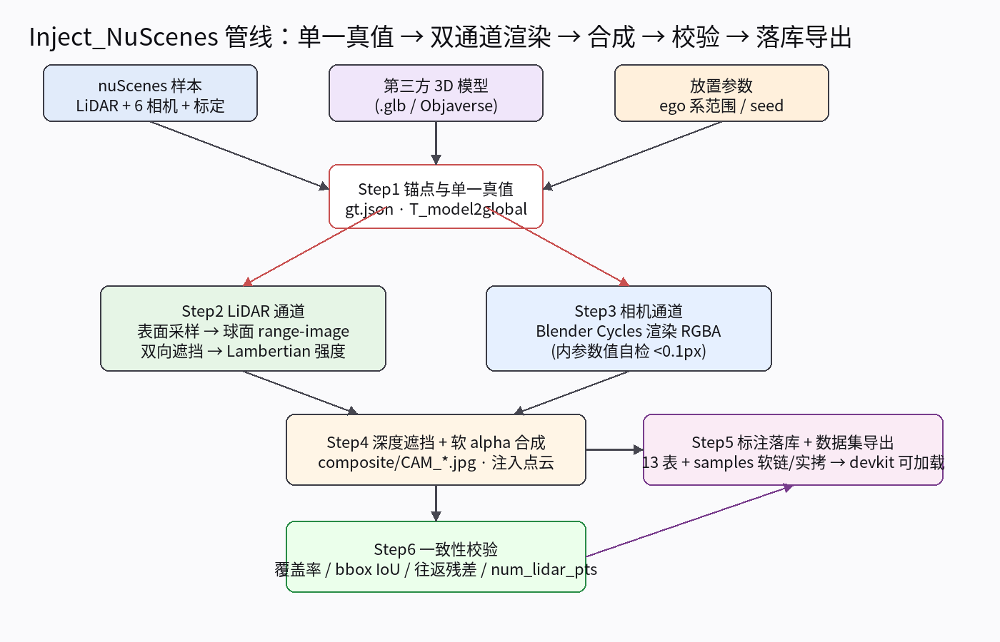
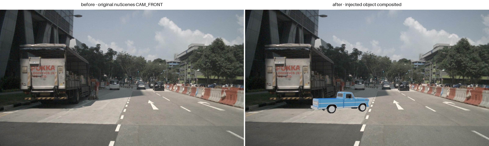
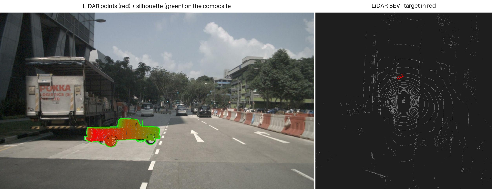
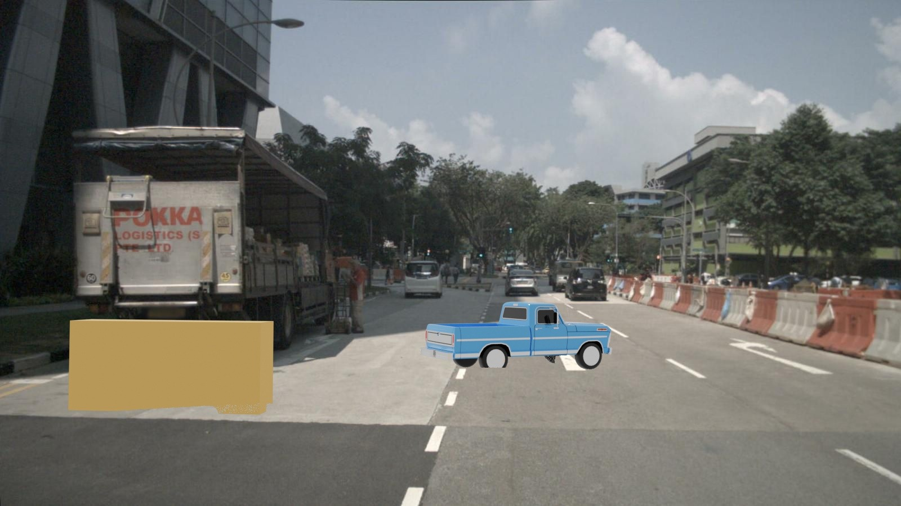
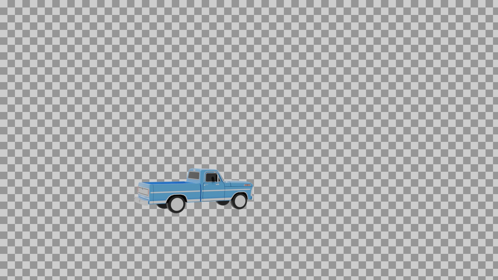

# nusc-inject 工作总结

向 **nuScenes** 的 LiDAR 点云与相机图像中**同步、几何一致**地注入第三方（OoD）3D 目标，并导出**标准 nuScenes 格式**、可被 `nuscenes-devkit` 直接加载的标注数据集。

- 方法文档：`nuScenes点云图像同步注入方法.md`
- 数据：nuScenes **v1.0-mini**（10 scene，6 相机 + LIDAR_TOP + RADAR）
- 环境：conda `nusc-inject` + Blender 3.6.23（Cycles CPU）

---

## 1. 核心设计：一个真值、两个渲染通道



**图 0 · 整体管线**：单一真值 `T_model2global` 同时驱动 LiDAR 与相机两个通道，合成后做一致性校验，最后落库导出。

| 设计点 | 做法 |
|---|---|
| 单一真值源 | `gt.json` 中 `T_model2global`（归一化+缩放+位姿）同时驱动两通道，保证点云与图像里的目标严格同位 |
| LiDAR 通道 | trimesh 面积加权表面采样 → 球面 range-image **双向遮挡**（物体↔场景；场景点之间不去重；`sample_annotation` 3D 框作稠密遮挡体补无回波面）→ Lambertian 强度 |
| 相机通道 | Blender headless 渲染 RGBA 前景（Cycles CPU）→ 深度遮挡判定（LiDAR 稀疏深度 + `sample_annotation` 框面光栅化）→ 软 alpha 合成 |
| 一致性校验 | 点投影 ⊂ α 覆盖率、3D 框投影 IoU、坐标链往返、Blender 内参自检、`num_lidar_pts` |
| 落库导出 | `category/attribute/instance/sample_annotation` 四表追加 + `samples/` 逐文件软链（注入文件实拷） |

---

## 2. 七步流程

1. **Step 1 锚点**：在 ego 系给定放置范围（前向/横向/偏航角 + `min_spacing` + seed 确定性随机），换算到全局系得到目标位姿，写入 `gt.json`。
2. **Step 2 LiDAR 通道**：模型表面采样（glTF Y-up → Blender Z-up 换算，bbox 漂移守卫 >1mm 即 fail）→ 球面 range-image（W=2048）双向遮挡 → 注入点并入原始 `(N,5)` float32 点云。
3. **Step 3 相机通道**：视锥剔除后单次 Blender job 渲染多目标 RGBA；内参用数值自检网格搜索裁定（`lens=fx·36/W`、`shift_x/y` 公式，误差 0.006px）。
4. **Step 4 合成**：物体深度 vs 场景深度（LiDAR 稀疏点 + `sample_annotation` 框面光栅化的稠密遮挡体）做遮挡判定，仅 `visible` 像素 alpha 混合替换原图。
5. **Step 5 落库**：生成标注行 + 文件映射 `spec.json`，`annotation.export_dataset` 独占 token 生成（`sha256("injectnusc|"+…)` 确定性，重导出 token 稳定）。
6. **Step 6 校验**：五项检查全过才进导出（`all_pass`），失败记入 manifest。
7. **Step 7 下游**：`NuScenes(dataroot=export)` 直接加载；过滤注入目标用 `category == movable_object.anomaly`，渲染前 `patch_devkit_colormap` 注册颜色。

---

## 3. 关键结果（图文）

> 图 1–4 均由 `scripts/make_doc_figs.py` 从真实运行出图（`fig_temple` 单目标、
> `fig_two_final` 双目标），不是手绘。改动合成/遮挡代码后重跑该脚本即可刷新。
> 全量指标见 §4 与 [`docs/measurements.md`](../measurements.md)。

### 3.1 单样本 P0 验收（run-id `fig_temple`）



**图 1 · 注入前后对比**：左为原始 nuScenes CAM_FRONT，右为注入后——蓝色皮卡（`temple.glb`）已合成进路面，几何位置与点云一致。



**图 2 · 跨模态一致性**：左为注入的 LiDAR 点（红）密铺在渲染轮廓（绿）内，两通道逐像素对齐；
右为 BEV，红色即目标在自车前方。

校验数值（`validation_report.json`）：

| 校验项 | 实测 | 阈值 | 结果 |
|---|---|---|---|
| 坐标链往返残差 | 6.0e-14 | <1e-6 | ✅ |
| `num_lidar_pts` | 4202 | >0 | ✅ |
| Blender 内参自检 | 0.006 px | <2 px | ✅ |
| 点投影 ⊂ α 覆盖率 | 0.997 | ≥0.85 | ✅ |
| 3D 框投影 IoU | 0.884 | ≥0.5（触边豁免） | ✅ |
| 被遮挡像素 / 无理由遮挡 | 648（1.9%）/ **0** | 0 违例 | ✅ |

### 3.2 同帧多目标（run-id `fig_two_final`）



**图 3 · 同帧 2 目标、不同类目**：蓝色皮卡（`vehicle.car`，`size=[3.00, 1.34, 1.12]`）
与橙色护栏（`movable_object.barrier`，`size=[0.40, 2.20, 1.00]`）共用同一套 z-buffer
与一次 Blender job，各自带独立类目落库。

| 校验项 | CAM_FRONT | CAM_FRONT_LEFT |
|---|---|---|
| 点投影 ⊂ α 覆盖率 | 0.998 | 1.000 |
| 3D 框投影 IoU | 0.970 | 0.697（触边豁免） |
| 被遮挡像素 / 无理由遮挡 | 2564 / **0** | 0 / **0** |
| `num_lidar_pts` | 3591 | 5918 |

批量放置可复现：`np.random.default_rng([seed, sample_index])`。

### 3.3 Blender 前景通道



**图 4 · Step3 产物**：Blender Cycles 渲染的 RGBA 前景（棋盘格=透明区），再经 Step4 深度遮挡与软 alpha 合成回原图。

---

## 4. 数据集导出（Step5+）

导出根目录 `data/exports/nuscenes-od-p0/`：

```
v1.0-mini/     # 13 张表：原表 + 追加 category/attribute/instance/sample_annotation
samples/       # 逐文件软链原数据；被注入的 lidar/相机文件为真实拷贝
sweeps/ -> 原数据   maps/ -> 原数据
export_report.json
```

**最终导出状态**（`export_report.json`，10-scene 轨迹版，`seed=42`）：

| 指标 | 值 |
|---|---|
| 覆盖场景 | 10 个 scene（scene-0061 … scene-1100） |
| 注入帧数 | 59 sample |
| 注入轨迹 | 15 tracks 实现（计划 20），59 帧标注 |
| 新增 annotation | **66** 条（总 18604 = 18538 + 66） |
| 新 category / attribute | `movable_object.anomaly` / `vehicle.moving` |
| 校验通过 | 59/59 帧（`end_reasons` 中无 `validation_failed`） |
| 遮挡成效 | 6.85% 目标像素被场景正确隐藏，0 违例无理由遮挡 |
| devkit 校验 | `verify.ok = true`，0 problems |

> 本节数字对应 `sample_annotation.size` 轴序修复、原始回波 gap-fill、遮挡体逐像素
> 深度、边缘目标覆盖率豁免等改动**之后**的导出。修复前同配置是 87 帧 / 20 轨迹 /
> 94 标注、且遮挡像素为 0（遮挡体几何错位导致遮挡完全失效）。逐项实测的复现方式与
> 原始输出见 [`docs/measurements.md`](../measurements.md)。

下游用法：

```python
from nuscenes.nuscenes import NuScenes
from nusc_inject.annotation import patch_devkit_colormap
nusc = NuScenes(version='v1.0-mini', dataroot='data/exports/nuscenes-od-p0')
patch_devkit_colormap(nusc, 'movable_object.anomaly')
# 注入目标：category == movable_object.anomaly
```

---

## 5. 过程中沉淀的关键事实（踩坑）

| 坑 | 结论 |
|---|---|
| `sample_data` 的 sweep 也带 `sample_token` | 按 sample 取传感器数据必须过滤 `is_key_frame=True`，否则拿到时间戳不一致的 sweep 帧 |
| glTF Y-up vs Blender Z-up | trimesh 保 Y-up、Blender 转 Z-up：`p_blender=(x,-z,y)`；不换算实测 bbox 漂移 291m |
| LIDAR_TOP 安装旋转 ≈ Rz(-90°) | lidar +x 指 ego **右**、+y 指 ego **前**——放置参数必须用 ego 系表达 |
| 内参 shift 符号歧义 | 用 `world_to_camera_view` vs numpy K 链数值自检（须先设目标分辨率）裁定 |
| 球面投影全轮回去重不保真 | 实测丢 21% 原始点；改为**双向遮挡**（场景点永不去重），无物体时 34688/34688 全保 |
| 边缘目标 IoU 结构性偏低 | 掩码触边时 bbox-IoU 豁免（覆盖率仍为硬约束）；α<500px 擦边相机整体跳过 |
| devkit colormap 是实例级 | 自定义类别须 `nusc.colormap.setdefault(name, rgb)`，工程已封装 `patch_devkit_colormap` |
| `export_dataset` 开头 `rmtree(export_root)` | 测试导出必须用独立 export_dir，否则摧毁成品导出树 |

---

## 6. 工程结构与复现

```
nusc-inject/
├── pyproject.toml · environment.yml   # 打包 + 固定版本环境
├── configs/base.yaml · p0.yaml · batch.yaml
├── scripts/setup_blender.sh | run_p0.py | run_batch.py | download_models.py
├── tests/                             # pytest 单测（无需数据与 Blender）
├── src/nusc_inject/
│   config · transforms · nusc_io · anchor · mesh_points · range_image
│   lidar_channel · camera_channel · blender_render · occluders · composite
│   validate · pipeline · annotation · visualize
└── tools/blender/          # 独立 Blender 3.6.23
```

复现命令：

```bash
conda activate nusc-inject
pip install -e .                      # 一次性：安装本包（含 pytest 单测）
pytest                                # 单测回归，无需数据与 Blender
# 单样本回归
python scripts/run_p0.py --config configs/p0.yaml --run-id my_run
# 批量注入 + 落库 + 导出（仅 all_pass 进导出）
python scripts/run_batch.py --config configs/batch.yaml --run-id my_batch
# 只重导出（须用可信 specs.json）
python scripts/run_batch.py --config configs/batch.yaml --export-only
```

---

## 7. 已完成 vs 后续

**已完成**
- ✅ P0 单样本同步注入，校验全过（`fig_temple`）
- ✅ 同帧多目标、多类目注入（共享 z-buffer + 确定性 seed，`fig_two_final`）
- ✅ 跨帧轨迹注入 10 scene，devkit 加载与渲染通过
- ✅ 标准 nuScenes 数据集导出 + token 确定性 + md5 对账
- ✅ **修复 `sample_annotation.size` 轴序**（nuScenes `[w,l,h]` vs 模型框 `x,y,z`）：
  该 bug 同时让落库框在 x-y 转 90°、并使真实车辆的遮挡体几何错位导致**遮挡完全失效**
  （修复前 94 个相机帧 `occluded` 全为 0）
- ✅ **补齐遮挡链路**：原始回波按角度 gap-fill 填扫描线空洞、遮挡体面改逐像素平面深度
  （误遮 3049 → 648）、物体深度洞填补且未知即可见、`depth_margin` 随深度缩放、
  边缘目标覆盖率豁免；新增遮挡理由一致性校验（0 违例）
- ✅ **规格保护**：退化 `scale` 输入、`from_global` 的 scale 回收、尺寸合理性阈值、
  `.obj/.fbx` 轴转换、漂移守卫改为形状敏感（bbox + 表面积 + 面积质心）
- ✅ 当前导出：59 帧 / 15 轨迹 / 66 标注，59/59 帧校验通过，devkit `verify.ok`

**后续（超出当前范围）**
- 批量到 150 scene / 训练数据集生产
- Objaverse 模型池扩充（`scripts/download_models.py` 已备）
- Inpainting 替换真实目标、map API 选点
- GPU 真实感化（SD inpaint / Magicdrive）——接口已预留，需 GPU 环境运行

---

## 8. 数据来源与许可

- **代码**：MIT（见仓库根目录 `LICENSE`）。
- **nuScenes 数据**：由 Motional 发布，遵循 **CC BY-NC-SA 4.0（署名-非商业性使用-相同方式共享）**。
  使用本仓库前需自行从 [nuScenes 官网](https://www.nuscenes.org/nuscenes) 下载数据并同意其条款。
- **本文档中的图像**（`figs/*.jpg`、`figs/*.png`）均为 nuScenes 相机图像经本管线处理后的衍生结果，
  仅用于说明方法效果，其版权与许可随原始数据，**不得用于商业用途**。
- 第三方 3D 模型（如 Objaverse 模型）各自保留原始许可，请勿随仓库分发。
