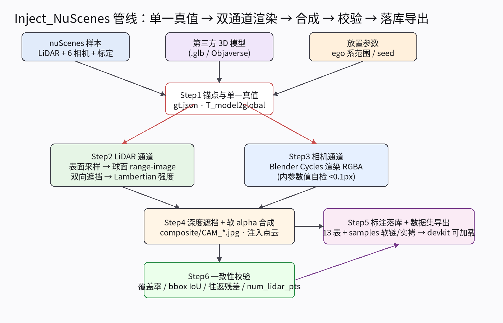
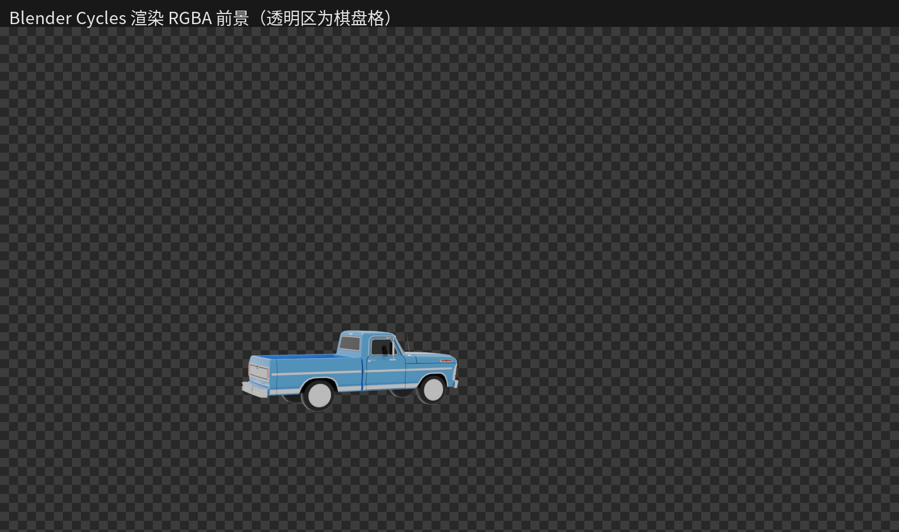
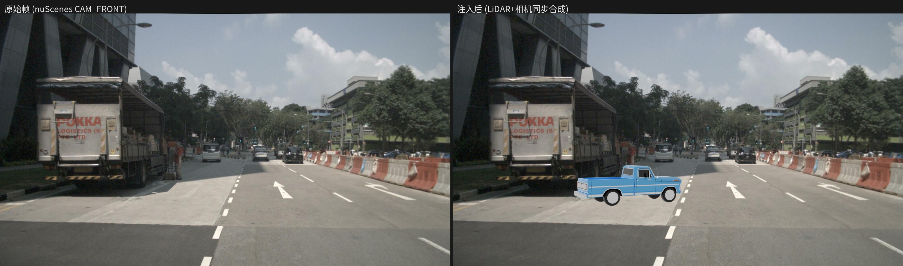
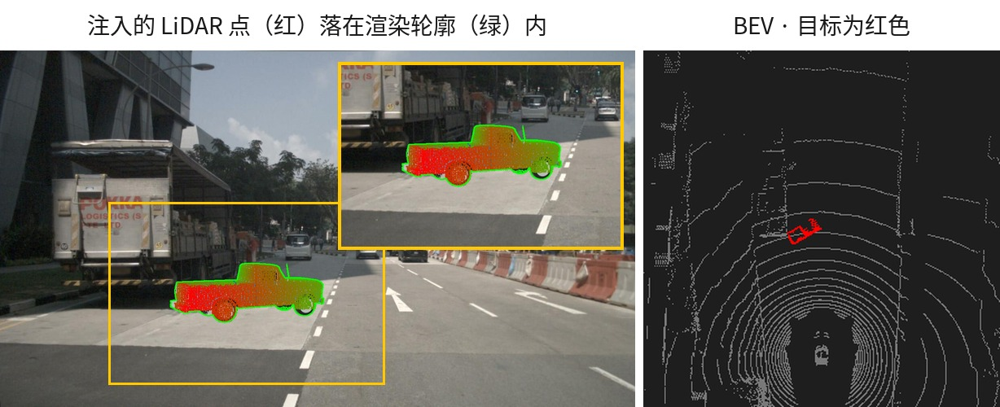
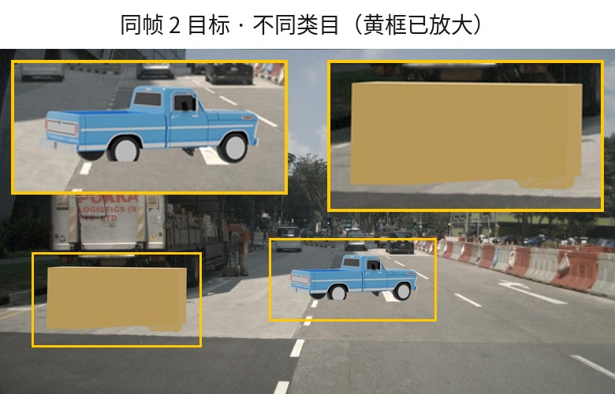

# 同步注入方法：向 nuScenes 点云 + 图像中植入第三方目标（跨模态一致）

> 目标：向 nuScenes 的 **LiDAR 点云** 与 **6 路相机图像** 中**同步、几何一致**地注入第三方（异常/OoD）目标，
> 生成一个"目标在两种模态里都可见、且 3D 真值唯一"的合成数据集。
>
> 本质：把 **S3AD（相机域图像编辑）** 与 **LIDO（LiDAR 域点云注入）** 两条路线，用一个**统一的全局坐标系锚点**缝合起来。
>
> **落地状态**：已在 nuScenes **v1.0-mini** 上完成 P0 单样本 → 批量多目标 → 跨帧轨迹 → 标准数据集导出全链路
> （10 scene / 87 帧 / 20 track / 94 条新标注，devkit 加载与渲染通过）。图文工作总结见 [`docs/summary/README.md`](docs/summary/README.md)。

---

## 0. 核心思想：一个真值、两个渲染通道、一个坐标锚点

```
                 ┌──────────────────────────────────────────┐
                 │   第三方 3D 模型（Objaverse / ModelNet）    │
                 │   .glb / .obj / CAD，含网格 + 纹理/材质      │
                 └──────────────────┬───────────────────────┘
                                    │ 统一缩放 / 旋转 / 平移 T_model2global
                                    ▼
              ┌─────────────────────────────────────────────────┐
              │          nuScenes 全局坐标系（global frame）      │
              │   目标位置 = ego_pose · calibrated_sensor · 偏移  │
              │   ← 唯一 3D 真值（category/translation/size/rot） │
              └───────────┬───────────────────────┬─────────────┘
                          │                       │
        ┌─────────────────▼─────────┐   ┌─────────▼──────────────────┐
        │   LiDAR 通道（点云域）      │   │   相机通道（图像域）         │
        │ ① 表面采样 → 稠密点云       │   │ ① Blender 渲染 → RGBA 前景  │
        │ ② range image 球面投影      │   │ ② 按相机内外参投影          │
        │ ③ 遮挡剔除（z-buffer）      │   │ ③ 深度/遮挡判定             │
        │ ④ Lambertian 反射算强度    │   │ ④ Alpha 合成到真实图像       │
        │ → 注入到 .bin 点云          │   │ → 写入 6 路相机 .jpg        │
        └───────────────────────────┘   └────────────────────────────┘
                          │                       │
                          └───────────┬───────────┘
                                      ▼
                    唯一的 sample_annotation（3D bbox 真值，两模态共享）
```



**图 0 · 已实现的整体管线**：`Step1` 锚点产出单一真值 `gt.json · T_model2global` → `Step2/Step3` 双通道并行渲染 → `Step4` 深度遮挡 + 软 alpha 合成 → `Step6` 五项一致性校验（`all_pass` 才进导出）→ `Step5` 标注落库 + 标准 nuScenes 数据集导出。

**三个铁律：**
1. **单一真值源**：3D bbox（translation + size + rotation + category）只在全局坐标系定义一次，LiDAR 和相机两个通道都从它推导，绝不各自独立标注。
2. **几何一致性**：LiDAR 里目标出现的方位/距离/尺寸，必须与相机图像里渲染出的目标**逐像素级对齐**，靠同一套外参（`calibrated_sensor`）保证。
3. **光学近似**：点云强度按 Lambertian 模型从标量反照率 `albedo` 推导；
   图像外观则由模型文件自带的 PBR 材质经 Cycles 渲染。两者**不是同一个来源**，
   亮度需要人工对齐（见 [`docs/model-input.md`](docs/model-input.md)）。

---

## 1. 预备：数据与依赖

| 依赖 | 用途 | 备注 |
|---|---|---|
| nuScenes 原始数据（点云 + 6 相机 + 元数据） | 作为"真实背景" | 当前使用 **v1.0-mini**（10 scene）；trainval 150 scene 通过 `configs/batch.yaml` 的 `dataset.scenes` 切换 |
| 第三方 3D 模型（.glb） | 注入目标素材 | `configs/batch.yaml` 的 `models:` 模型池（`target_max_dim_m` 可设 `[lo,hi]` 随机区间）；`scripts/download_models.py` 可拉 Objaverse |
| Blender 3.6.23 LTS（headless） | 图像通道渲染 | `scripts/setup_blender.sh` 独立安装到 `tools/blender/`，Cycles CPU（本机无 GPU） |
| nuscenes-devkit | 坐标读写、真值生成、校验 | `NuScenes` 加载导出数据集 + `export_dataset` 内置 verify |
| conda `nusc-inject` | host 侧编排 | `environment.yml` |

---

## 2. 方法流程（七步）

### Step 1 — 选锚点：在全局坐标系确定目标位姿

放置参数用 **ego 系**表达（前向/横向/偏航角随机范围 + `min_spacing_m` + `seed` 确定性随机），换算到全局坐标系：

```
T_model2global = T_ego2global · T_lidar2ego · T_model2lidar
```

- `T_ego2global`：该 sample 的 `ego_pose.json`（四元数 + 平移）
- `T_lidar2ego`：LIDAR_TOP 的 `calibrated_sensor.json` 外参。**注意 LIDAR_TOP 传感器系相对 ego 约有 -90° 偏航安装旋转**（`R_l2e≈Rz(-90°)`），所以必须在 ego 系表达放置参数、anchor 内部换算
- `T_model2lidar`：由随机缩放（`target_max_dim_m`）+ 随机 yaw + 贴地偏移合成

**这一步产出唯一真值**（后续两个通道都用它，写入 `gt.json`）：
```json
{ "category": "anomaly",
  "translation": [gx, gy, gz],
  "size": [w, l, h],
  "rotation": [qw, qx, qy, qz],
  "T_model2global": [[...], [...], [...], [...]] }
```

> **`size` 轴序**：nuScenes 的 `sample_annotation.size = [w, l, h]`，其中**长度 `l` 沿框 x 轴、
> 宽度 `w` 沿框 y 轴**（见 devkit `Box.corners`）。模型框的 `(x, y, z)` 边长对应 `[l, w, h]`，
> 因此落库时须写成 `[y_extent, x_extent, z_extent]`，不能原样照搬。

> **跨帧轨迹模式**（`objects.tracking.enabled`）：每个 track 是一个**世界系静止**目标，在起始帧放置一次，
> 后续帧冻结同一个 `T_model2global`（`anchor.py` 的 `from_global`），跨帧 prev/next 由落库阶段串联。

### Step 2 — LiDAR 通道：表面采样 + 球面投影注入

对 3D 模型做 **LiDAR 物理仿真**，生成"如果真有这个物体，32 线 LiDAR 会扫到什么"：

1. **表面采样**：trimesh 按面积加权采样稠密点（`mesh_points.n_dense=300000` / `n_lidar=12000`），得到物体点云。
   **坐标约定**：glTF 是 Y-up、Blender 是 Z-up，统一转换 `p_blender=(x,-z,y)`，运行时 bbox 对账（漂移 >1mm 即 fail；不换算实测漂移 291m）。
2. **变换**：施加 `T_model2lidar`，转到该帧 LiDAR 传感器坐标系。
3. **球面投影（range image，H=512 / W=2048，elev ∈ [-30.67°, 10.67°]）**：把"原始点云 + 物体点云"合并后投影到球面距离图，天然完成**遮挡剔除**（同一射线只保留最近点）。
   - **双向遮挡语义**（关键）：物体点取每格最近且严格更近者；**场景点仅被更近的物体剔除，场景点之间永不去重**——保证原始点云除被物体遮挡处外逐点保留（早期全轮回去重实测丢 21% 原始点，已废弃）。
   - **稠密遮挡体**：`sample_annotation` 的 3D 框面（`occluders.py`，64 点/面网格）补进 range-image，填补玻璃/无回波面的深度空洞。
4. **强度赋值**：按材质反射率 ρ 用 Lambertian 模型算每个物体点的强度（`I = k·ρ·cos(入射角)`，`intensity_gain_k=200`），非物体点保留原强度。
5. **反投影回 3D**：从 range image 反投影，得到注入后的 `.bin` 点云——nuScenes 原生为 float32 **(N,5)**（含 ring 列），按此写出。

### Step 3 — 相机通道：Blender 渲染前景

对**同一个模型、同一个位姿**，做图像渲染：

1. 视锥剔除（`frustum_margin_px=40`）后，**单次 Blender job 渲染多目标** RGBA 前景（Cycles CPU，64 samples，`film_transparent=True`）。
2. 相机内外参：从 `calibrated_sensor.json` 读 `camera_intrinsic`（K），外参 + `ego_pose` 反解相机在全局系的位姿；Blender 世界系 ≡ nuScenes 全局系（右手 z-up），相机系相差绕 X 轴 180°（`diag(1,-1,-1)`）。
3. **内参映射并做数值自检**（网格搜索裁定，误差 0.006px < 2px 阈值）：
   `lens = fx·36mm/W`，`shift_x = -(cx-W/2)/W`，`shift_y = +(cy-H/2)/W`，`sensor_fit='HORIZONTAL'`。



**图 4 · Step 3 产物**：Blender Cycles 渲染的 RGBA 前景（棋盘格 = 透明区），只含目标、无背景，交由 Step 4 做深度遮挡与软 alpha 合成。

### Step 4 — 相机通道：深度遮挡判定 + Alpha 合成

把前景图贴到真实相机图像前，**必须做遮挡判定**（否则目标会"浮"在被遮挡物之上）：

1. **场景深度** = LiDAR 稀疏深度（该帧投影，按 `scene_gap_fill_deg` **角度膨胀**填掉扫描线之间的空洞）+ **`sample_annotation` 3D 框面逐像素光栅化**（`occluders.box_depth_raster`）的稠密遮挡体——玻璃/无回波面也能遮挡。
   **目标深度**是模型**表面采样点投影**建的 z-buffer（`n_dense=300000` 稠密采样），
   不是 Blender 的渲染 z-pass——采样漏掉的像素会先在 α 掩码内做邻域填补，
   仍填不上的按「未知即可见」处理，避免把 Blender 真画出来的轮廓误删。
2. 对前景图每个像素：若目标深度 > 场景深度（容差 = `depth_margin_m + depth_margin_rel × 深度`，
   近处约 0.3 m、60 m 处约 1.4 m）则该像素不贴（保持背景）；否则按 `alpha_threshold=0.05` 软 alpha 混合贴入。
3. 6 路相机各自独立执行；**α 像素 < `min_alpha_px=500` 的相机整体跳过**（目标在画幅外/擦边）。



**图 1 · 注入前后对比**：左为原始 nuScenes `CAM_FRONT`，右为注入后——蓝色皮卡（temple.glb）已合成进路面，几何位置与点云严格一致（同一 `T_model2global`）。

### Step 5 — 生成 nuScenes 标准标注（单一真值落库）

把 Step 1 的 3D 真值写入 nuScenes 关系表，并保证**能被 devkit 正常读**：

- `category.json`：新增 `movable_object.anomaly`
- `attribute.json`：新增/复用 `vehicle.moving`
- `instance.json`：新 instance_token（轨迹模式下跨帧共享，prev/next 链由落库串联）
- `sample_annotation.json`：translation/size/rotation + `sample_data_token`（LIDAR_TOP）+ `num_lidar_pts`（从 Step 2 实际注入点数算）+ `num_radar_pts=0` + `visibility_token`

**工程要点**：
- **token 确定性**：`sha256("injectnusc|"+…)` 生成，重导出 token 稳定、可复现对账。
- **导出布局**：`data/exports/nuscenes-od-p0/` 下 13 张表（原表 + 追加 4 表）、`samples/` 逐文件软链原数据（被注入的 lidar/相机文件为**真实拷贝**）、`sweeps/` `maps/` 软链；`export_dataset` 开头会 `rmtree(export_root)`，**测试导出务必用独立 export_dir**。
- **自定义类别渲染**：devkit `render_*` 需 `patch_devkit_colormap(nusc, 'movable_object.anomaly')` 注册颜色（colormap 是实例级 `setdefault`）。

### Step 6 — 一致性校验（关键，`all_pass` 才进导出）

| 检查项 | 方法 | 阈值 |
|---|---|---|
| 坐标链往返残差 | `T_model2global` 全链正/反变换对账 | <1e-6（实测 ~1e-13） |
| `num_lidar_pts` | 逐目标注入点数 | 全部 >0 |
| Blender 内参自检 | `world_to_camera_view` vs numpy K 链数值网格 | <2 px（实测 0.006 px） |
| 点投影 ⊂ α 区域覆盖率 | 注入点投影落进渲染 α 掩码的比例 | ≥0.85（实测 ≥0.98） |
| 3D 框投影 IoU | 3D bbox 8 角点投影 AABB vs α AABB | ≥0.5（**掩码触边豁免**，覆盖率仍为硬约束） |



**图 2 · LiDAR 侧可视化（Step 6 佐证）**：左为注入点（红）+ 3D 框（绿）投影回图像，与合成区域重合；右为 BEV，红框即注入目标在自车前方的位置——两模态同位。

### Step 7 — 下游复用

- **标准数据集直接加载**：
  ```python
  from nuscenes.nuscenes import NuScenes
  from nusc_inject.annotation import patch_devkit_colormap
  nusc = NuScenes(version='v1.0-mini', dataroot='data/exports/nuscenes-od-p0')
  patch_devkit_colormap(nusc, 'movable_object.anomaly')
  # 注入目标过滤：category == 'movable_object.anomaly'（token 确定性可复现）
  ```
- **LiDAR 检测/分割**：MMDetection3D / LIDO，用 `num_lidar_pts` 过滤、评估 mAP/NDS 或逐点 IoU。
- **相机 3D 检测**：FCOS3D/PGD（mono3d），用 2D bbox + 3D 真值。
- **跨模态异常检测**：两模态真值共享，可做"点云能检出、图像漏检"等一致性消融。

---

## 3. 关键技术难点与对策

| 难点 | 对策 |
|---|---|
| **跨模态错位**（点云在 A 处、图像目标在 B 处） | 单一 `T_model2global` 锚点；Step 6 投影一致性校验兜底（覆盖率 + bbox IoU 双约束） |
| **LiDAR 稀疏性**（远/小目标点太少） | 表面采样密度可控（`n_dense`）；仍过小则接受"α<500px 擦边相机跳过"，`num_lidar_pts` 如实记录 |
| **遮挡一致性**（点云被挡、图像却贴了） | 两通道共用**同一份场景几何**：LiDAR 稀疏点（角度膨胀填扫描线空洞）+ `sample_annotation` 框面稠密遮挡体（`occluders.py`），同时进 range-image 与图像深度缓冲；Step 6 校验**每个被遮挡像素必须有更近的场景几何**（`occlusion_justified`），无理由遮挡即判失败 |
| **场景点被误删** | 双向遮挡：只删"被更近物体挡住的场景点"，场景点之间不去重（无物体时 34688/34688 全保） |
| **强度 vs 亮度域不匹配** | 点云强度由标量 `albedo` 经 Lambertian 推导，图像外观由模型自带 PBR 材质经 Cycles 渲染——**两个独立来源**，不自动一致。按 `docs/model-input.md` 的说明人工对齐 `albedo` |
| **6 相机拼接缝** | 每路相机独立用其外参 + `ego_pose` 渲染合成，不做跨相机插值 |
| **模型坐标系漂移**（glTF Y-up vs Blender Z-up） | `mesh_points.py` 统一 `(x,-z,y)` 转换 + 运行时 bbox 对账 >1mm 即 fail |
| **边缘目标 IoU 结构性偏低** | 掩码触边时 bbox-IoU 豁免（覆盖率仍为硬约束）；α<500px 相机整体跳过 |

---

## 4. 与两条原路线的对照（为什么是"完善方法"）

| 维度 | S3AD（纯图像） | LIDO（纯点云） | **本方法（联合注入）** |
|---|---|---|---|
| 图像里可见异常目标 | ✅ | ❌ | ✅ |
| 点云里可见异常目标 | ❌ | ✅ | ✅ |
| 真值一致性 | 单一（相机系） | 单一（逐点） | **单一（全局 3D bbox，两模态共享）** |
| 遮挡处理 | 有（擦除+贴图） | 有（range image） | **有（两通道统一几何 + 稠密遮挡体）** |
| 物理一致性 | 视觉渲染 | 反射率 | **反射率统一驱动两者** |
| 下游覆盖 | 视觉检测 | LiDAR 分割 | **两者 + 跨模态 + 标准 nuScenes 导出** |

---

## 5. 落地状态与验收结果

### 5.1 分阶段进度

| 阶段 | 内容 | 状态 |
|---|---|---|
| P0 | 单样本最小闭环（Step 1+2+3+4+6），验证"点云投影落点 ⊂ 图像渲染目标区域" | ✅ `p0_final` 五项全过 |
| P1 | 单模态各自跑通（LiDAR 注入 / Blender 渲染独立可复现） | ✅ |
| P2 | 联合 + 真值落库（Step 5）+ 批量多目标 | ✅ `p0_batch_v3`，5 sample × 2 obj → 5/5 all_pass |
| P3 | 跨帧轨迹 + 规模化 + 数据集导出 | ✅（mini 版）10 scene / 87 帧 / 20 track / 94 标注，devkit verify 通过；**trainval 150 scene 待跑** |

### 5.2 单样本验收（`validation_report.json`）

| 校验项 | 实测 | 阈值 | 结果 |
|---|---|---|---|
| 坐标链往返残差 | 6.0e-14 ~ 1.7e-13 | <1e-6 | ✅ |
| `num_lidar_pts`（逐目标） | 1823（多目标逐个 >0） | >0 | ✅ |
| Blender 内参自检 | 0.006 ~ 0.021 px | <2 px | ✅ |
| 点投影 ⊂ α 覆盖率 | 0.980 ~ 0.996 | ≥0.85 | ✅ |
| 3D 框投影 IoU | 0.756 ~ 0.935（触边豁免） | ≥0.5 | ✅ |

### 5.3 批量与轨迹注入



**图 3 · 同帧 2 目标批量注入（`p0_batch_v3`）**：多个模型按 `seed` 确定性随机放置（`np.random.default_rng([seed, sample_index])`），共用同一 range-image z-buffer——**目标之间互相遮挡**，单次 Blender job 渲染。

- 批量（legacy 模式）：5 sample × 2 obj → **5/5 all_pass**，10 条新标注。
- 轨迹（tracking 模式）：10 scene / 87 帧 / 20 track（时长 3–8 帧）/ **94 条新 annotation**（总 18632 = 18538 + 94），结束原因 `window_end=14 / no_camera=6`。

### 5.4 数据集导出（Step 5 成品）

`data/exports/nuscenes-od-p0/export_report.json`：

| 指标 | 值 |
|---|---|
| 覆盖场景 | 10 个 scene（scene-0061 … scene-1100） |
| 注入帧数 / 文件 | 87 sample；`samples/` 共 4848 个文件（软链 + 注入实拷） |
| 新增 annotation / instance | 94 / 20 |
| 新 category / attribute | `movable_object.anomaly` / `vehicle.moving` |
| devkit 校验 | `verify.ok = true`，0 problems；`render_sample` 渲染通过 |

---

## 6. 过程中沉淀的关键事实（踩坑）

| 坑 | 结论 |
|---|---|
| `sample_data` 的 sweep 也带 `sample_token` | 按 sample 取传感器数据必须过滤 `is_key_frame=True`，否则拿到时间戳不一致的 sweep 帧 |
| glTF Y-up vs Blender Z-up | trimesh 保 Y-up、Blender 转 Z-up：`p_blender=(x,-z,y)`；不换算实测 bbox 漂移 291m |
| LIDAR_TOP 安装旋转 ≈ Rz(-90°) | lidar +x 指 ego **右**、+y 指 ego **前**——放置参数必须用 ego 系表达 |
| 内参 shift 符号歧义 | 用 `world_to_camera_view` vs numpy K 链数值自检（须先设目标分辨率）裁定 |
| 球面投影全轮回去重不保真 | 实测丢 21% 原始点；改为**双向遮挡**（场景点永不去重），无物体时 34688/34688 全保 |
| 边缘目标 IoU 结构性偏低 | 掩码触边时 bbox-IoU 豁免（覆盖率仍为硬约束）；α<500px 擦边相机整体跳过 |
| devkit colormap 是实例级 | 自定义类别须 `nusc.colormap.setdefault(name, rgb)`，工程已封装 `patch_devkit_colormap` |
| `export_dataset` 开头 `rmtree(export_root)` | 测试导出必须用独立 export_dir，否则摧毁成品导出树 |

---

## 7. 工程结构与复现

```
nusc-inject/
├── configs/p0.yaml · batch.yaml          # 放置范围/模型池/遮挡体/校验阈值/落库类别
├── scripts/setup_blender.sh | run_p0.py | run_batch.py | download_models.py
├── src/nusc_inject/
│   transforms.py      # 四元数/坐标链/OpenCV↔Blender 相机转换
│   nusc_io.py         # 元数据（keyframe 过滤）+ lidar .bin I/O
│   anchor.py          # Step1 锚点位姿 + gt（含跨帧 from_global 冻结）
│   mesh_points.py     # 表面采样（glTF→Blender 系 + bbox 对账）
│   lidar_channel.py   # Step2 双向遮挡 + Lambertian 强度
│   occluders.py       # sample_annotation 框面稠密遮挡体（range-image + 图像深度）
│   camera_channel.py  # Step3 视锥剔除 + Blender 调度（多目标单 job）
│   blender_render.py  # 【Blender 内】bpy 渲染 + 内参自检
│   composite.py       # Step4 深度遮挡 + 软 alpha 合成（多目标）
│   validate.py        # Step6 五项校验（all_pass 才进导出）
│   pipeline.py        # 共享单样本流程（run_p0 与 run_batch 复用）
│   annotation.py      # Step5 标注行 + 数据集导出 + devkit 校验 + colormap 补丁
│   visualize.py       # 叠加/BEV 可视化
└── tools/blender/     # 独立 Blender 3.6.23 LTS
```

复现命令：

```bash
conda activate nusc-inject
# 单样本回归（P0）
python scripts/run_p0.py --config configs/p0.yaml --run-id my_run
# 批量注入 + 落库 + 导出（仅 all_pass 进导出；tracking 由 batch.yaml 控制）
python scripts/run_batch.py --config configs/batch.yaml --run-id p0_batch_v3
# 只重导出（须用可信 specs.json）
python scripts/run_batch.py --config configs/batch.yaml --export-only
```

---

## 8. 结论

这套"同步注入"方法的核心竞争力在于**一个全局坐标锚点 + 反射率统一驱动 + 两个渲染通道共享单一真值**，
从根上解决了纯图像（看不见点云）和纯点云（看不见图像）各自的天生缺陷，为跨模态异常检测提供了物理和几何都自洽的合成数据。
工程上最大的风险点是**跨模态几何对齐**，已用 P0 最小闭环 + Step 6 五项硬校验（`all_pass` 门禁）解决；
当前已在 v1.0-mini 上跑通"注入 → 校验 → 落库 → 标准数据集导出 → devkit 加载渲染"全链路，
下一步是 trainval 150 scene 规模化与下游训练接入。
