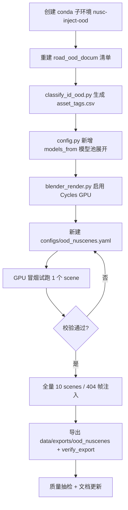

# ood_nuscenes 数据集生成计划

## 一、目标与口径

基于本工程的点云/图像同步注入管线，把 **road_ood 模型池中符合「边界外（OOD）」定义的第三方带贴图模型** 随机注入 nuScenes v1.0-mini，导出标准 nuScenes 格式数据集 `data/exports/ood_nuscenes`。

已确认的口径决策：

| 决策项 | 结论 |
|---|---|
| OOD 筛选 | 严格 OOD：[`road_ood_asset_tags.csv`](../assets/models/road_ood_docum/road_ood_asset_tags.csv) 中 `tier == "OOD"`（nuScenes 23 类税则之外；不含 ID-TAIL 灰区） |
| 注入通道 | 点云 + 图像同步注入（工程核心：单一 `T_model2global` 真值驱动双通道） |
| 数据规模 | v1.0-mini 全量 10 scenes / 404 关键帧 |
| 注入模式 | tracking 跨帧轨迹：每 scene 2 条 OOD 轨迹，世界系静止、prev/next 链式标注 |
| 类目 | `movable_object.anomaly`（asset_tags 的 `ood_category` 列即此值） |
| 渲染 | Blender Cycles **GPU**（本地显卡；OPTIX→CUDA→CPU 自动回退） |
| 环境 | 新建 conda 子环境 `nusc-inject-ood`（与现有 `nusc-inject` 隔离） |
| 导出名 | `ood_nuscenes`（沿用用户命名） |

## 二、现状盘点

- **管线已完备**：[`run_batch.py`](../scripts/run_batch.py) 的 tracking 模式 → [`pipeline.run_sample`](../src/nusc_inject/pipeline.py:37) 七步 → [`annotation.export_dataset`](../src/nusc_inject/annotation.py:120) 导出 + [`verify_export`](../src/nusc_inject/annotation.py:333) devkit 校验，全部可复用，**无需重写核心**。
- **缺口 1 — OOD 判定文档缺失**：`assets/models/road_ood_docum/` 当前不存在（模型 glb 已平铺在 `assets/models/`，但清单/标签 CSV 缺失）。[`classify_id_ood.py`](../scripts/classify_id_ood.py:36) 依赖 `road_ood_manifest.csv`，而该文件由 [`download_road_ood.py`](../scripts/download_road_ood.py:254) 联网下载后写出。
- **缺口 2 — 模型池静态**：[`configs/batch.yaml`](../configs/batch.yaml:16) 的 `models:` 是写死的单条列表；无法表达「从 3000+ 资产中按 tier 过滤」。
- **缺口 3 — 渲染在 CPU**：[`blender_render.py`](../src/nusc_inject/blender_render.py:86) 只设 `scene.cycles.device`，未启用 Blender 的 compute device（preferences 层），且 `read_factory_settings` 会重置 preferences——必须在 reset 之后补设备启用代码。
- **残留**：`assets/models/` 存在下载中断的临时文件（`.part` / `.*.AaERFk`），需清理，避免污染扫描。

## 三、总体流程



## 四、分步实施

### Step 1 — 环境隔离（conda 子环境）

```bash
conda env create -f environment.yml -n nusc-inject-ood   # -n 覆盖 yml 内 name
conda activate nusc-inject-ood
pip install -e .
python -m pytest -q          # 基线：改动前全绿
```

Blender 已就绪（`tools/blender-3.6.23-linux-x64/` + `setup_done.marker`），验证 `tools/blender/blender --version` 与 `nvidia-smi`（确认显卡可用）。

### Step 2 — 重建 road_ood_docum 判定文档

1. 清理 `assets/models/` 下 `.*.part`、`.*.AaERFk` 等下载残留。
2. **首选离线重建**（不依赖网络）：给 [`download_road_ood.py`](../scripts/download_road_ood.py) 加 `--from-sidecars` 模式——扫描 `assets/models/*.glb` + 同名 `.json` sidecar，复用现有 [`write_manifest`](../scripts/download_road_ood.py:254) 写出 `road_ood_manifest.csv`（字段全部可从 sidecar 取得：`lvis_class / class_cn / group / materialCount / textureCount / size_MB`，`group_cn` 查 `GROUPS` 表）。
   - 备选：联网重跑 `python scripts/download_road_ood.py`（已存在文件走 `status=exists` 跳过，最终同样写出 manifest）。
3. 运行 `python scripts/classify_id_ood.py`，产出三份文档：
   - `road_ood_class_map.csv`（108 类三档判定）
   - `road_ood_OOD_CLASSES.md`（人类可读清单）
   - `road_ood_asset_tags.csv`（**逐文件 tier/is_ood 标签——筛选的单一事实来源**）

### Step 3 — 模型池动态展开（config.py）

在 [`load_config`](../src/nusc_inject/config.py:41) 末尾新增 `models_from` 展开逻辑（保持向后兼容，`models:` 静态列表继续可用）：

```yaml
models_from:
  tags_csv: assets/models/road_ood_docum/road_ood_asset_tags.csv
  filter: { tier: OOD }            # 严格边界外
  defaults:
    albedo: 0.6
    intensity_gain_k: 200.0
    category: movable_object.anomaly
  # target_max_dim_m 按 group 随机范围（mm 级小件与大型设施差异大）
  size_by_group:
    animals:          [0.4, 2.0]
    dropped_items:    [0.4, 2.5]
    road_facilities:  [0.5, 3.0]
    atypical_actors:  [0.8, 3.0]
    construction:     [2.0, 6.0]
```

展开产物即 `cfg["models"]`（每条含 `path / target_max_dim_m / albedo / intensity_gain_k / category`），[`_plan_one`](../scripts/run_batch.py:36) 的随机池采样与区间尺寸采样**零改动**直接生效。补 `tests/test_config.py` 单测：过滤正确性、路径绝对化、静态 `models:` 不受影响。

### Step 4 — Cycles GPU 启用（blender_render.py）

在 [`reset_scene`](../src/nusc_inject/blender_render.py:79) 中 `read_factory_settings` **之后**（preferences 会被 factory reset 清掉）：

1. `cycles_device == GPU` 时：依次尝试 `OPTIX` → `CUDA` → 回退 `CPU`（`preferences.get_devices()` 枚举并启用）；
2. job 里透传设备选择结果，日志打印实际生效设备（便于确认真的跑在显卡上）；
3. `cycles_device` 保持配置驱动（[`camera_channel.py`](../src/nusc_inject/camera_channel.py:124) 已透传），`configs/ood_nuscenes.yaml` 设 `GPU`；
4. 自检（`selfcheck_max_pixel_err`）是投影几何自检，不受设备影响，继续沿用。

### Step 5 — 新建 configs/ood_nuscenes.yaml

```yaml
extends: base.yaml
run_id: ood_nuscenes_v1
output_dir: data/outputs/OoD
dataset: { scenes: null }          # 全量 10 scenes
models_from: { ... }               # Step 3 的 OOD 过滤配置
objects:
  count: 2
  strategy: random_forward
  forward_range_m: [8.0, 30.0]
  lateral_range_m: [-4.0, 4.0]
  seed: 42
  tracking: { enabled: true, length: [3, 8], forward_range_m: [12.0, 35.0] }
camera_channel: { cycles_device: GPU, cycles_samples: 64 }
annotation: { category_name: movable_object.anomaly }
export_dir: data/exports/ood_nuscenes
```

### Step 6 — 冒烟试跑（1 scene）

```bash
python scripts/run_batch.py --config configs/ood_nuscenes.yaml --run-id smoke
```

验收点：GPU 设备日志生效、Blender 渲染无报错、`validate` 通过率、`export_report.json` 的 `verify.ok == true`、叠加可视化肉眼检查注入目标贴地/遮挡/比例合理。不通过则调 `forward_range / 尺寸表 / validation` 阈值后重试。

### Step 7 — 全量生成

```bash
python scripts/run_batch.py --config configs/ood_nuscenes.yaml --run-id ood_nuscenes_v1
```

tracking 模式只对「有活跃轨迹的帧」跑渲染（每 scene 2 条 × 均长 ~5.5 帧 ≈ 110–150 帧实际注入），其余帧原样软链，规模可控。产出：

- `data/outputs/OoD/ood_nuscenes_v1/` — specs.json / batch.log / 逐帧可视化
- `data/exports/ood_nuscenes/` — **交付物**：标准 nuScenes 格式（注入图像为实体文件，其余 samples 软链，sweeps/maps 软链），含 `specs.json` + `export_report.json`

### Step 8 — 质量抽检与文档

1. devkit 加载：`NuScenes(version='v1.0-mini', dataroot='data/exports/ood_nuscenes')` + `patch_devkit_colormap`，渲染抽查；
2. 统计：注入帧数、轨迹数与长度分布、OOD 类目分布、`num_lidar_pts` 分布；
3. 更新 [`README.md`](../README.md) 与 [`docs/reference.md`](../docs/reference.md)：ood_nuscenes 生成命令、口径说明、复现步骤。

## 五、风险与对策

| 风险 | 对策 |
|---|---|
| 离线重建 manifest 字段与联网版有出入 | classify 仅依赖 6 个统计字段，sidecar 全部具备；跑完后用 `--report` 核对类目数=108 |
| Blender GPU 不可用（驱动/CUDA 缺失） | OPTIX→CUDA→CPU 三级回退，日志明确打印实际设备；CPU 仅是速度慢，结果等价 |
| 小件 OOD 目标过小被 `min_alpha_px / num_lidar_pts` 剔除导致轨迹早夭 | 尺寸表下限设 0.4 m；冒烟阶段观察 `end_reasons` 分布，必要时上调 |
| `export_dataset` 每次 `rmtree(export_root)` 重建 | export_dir 固定指向 `data/exports/ood_nuscenes`，不与既有 `nuscenes-od-*` 冲突 |
| 404 帧全量耗时 | GPU 渲染 + tracking 只渲染活跃帧；先冒烟实测单帧耗时再放量 |

## 六、实施结果（2026-11-08 收官）

**交付物 `data/exports/ood_nuscenes/`**：9 instances / 32 annotations / 32 samples，
devkit `verify_export ok`，注入类目全部 `tier==OOD`（8 类：chair / telephone_booth /
fireplug / generator / tractor / bookcase / bed / telephone_pole），最长边 0.61–5.43 m，
`num_lidar_pts` 中位 339。pytest 165 项全绿；Cycles 实际设备 `GPU via OPTIX — RTX 5090`。

执行中发现并修复的**四个计划外问题**：

1. `load_config` 的 `extends` 只展平一层（`ood_smoke → ood_nuscenes → base` 断链）
   —— 改为循环展平（`config.py`），补链式继承测试；
2. **Blender 层级资产丢 scale**（本计划最重要发现）：glTF 多节点资产（15 mesh 挂
   Sphere/Bezier 父级）上 `matrix_world` 赋值经依赖图更新后丢失 `T` 的 scale 半段，
   55 m 原型按原尺寸渲染、LiDAR 却是缩放后的 2.37 m——图像/点云跨通道不一致，
   且 bbox/vsig/selfcheck 各自只与同侧比对全部误过。修复：**先解父烘焙层级为平面
   几何，再施加单一真值**（`blender_render.py`）；
3. **三道质量闸**（用户两轮反馈落地）：完全遮挡目标不绘制不标注
   （`min_visible_px`）、车驶近贴脸帧跳过（`min_obj_camera_dist_m`，曾产出黑帧）、
   `size_by_class` 50 类常识尺寸表（灭火器不会长到 3 m）+ `max_size_m` 兜底；
4. 批量模式 `no camera composited` 由致命错误降级为 `no_camera`（细杆目标
   alpha<500 不再中断整个运行）。

命名规范勘误：`odd` → `ood/OoD`（配置、run_id、outputs 目录、计划文件全面纠正）。
复现命令见 README「跑起来」，配置与闸门详解见 `docs/reference.md` 第一部分。
